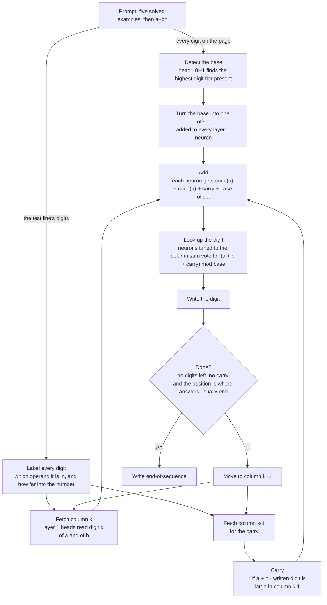
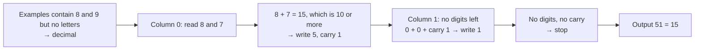
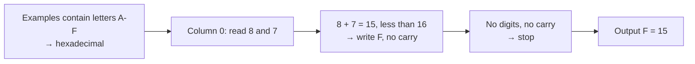
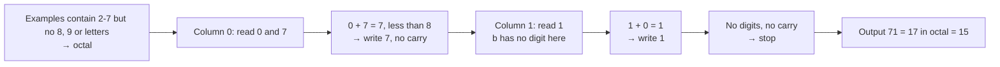
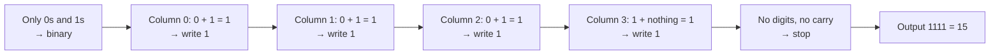
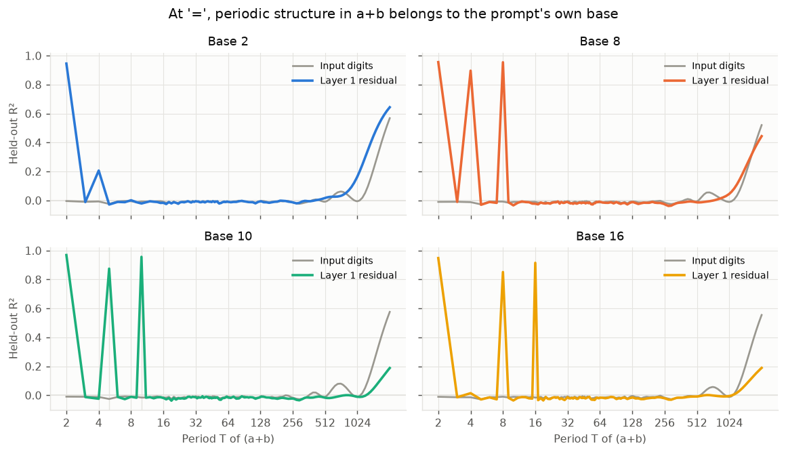
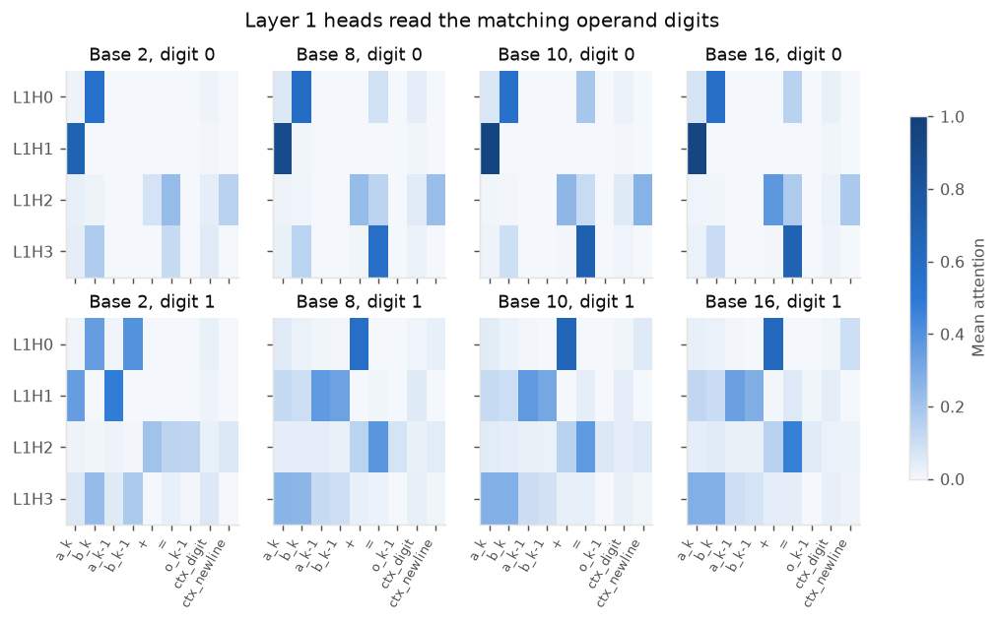
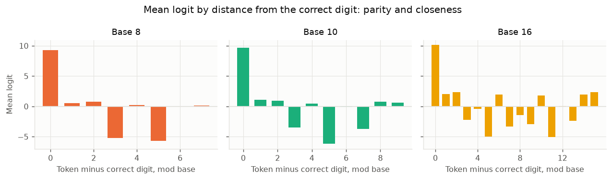
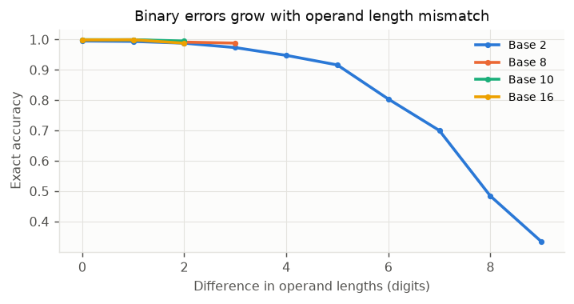
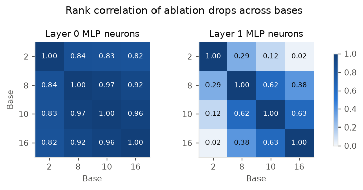

# How `L2_H4_D64` adds in bases 2, 8, 10 and 16

**Model:** `CrossBaseArithmetic/arithmetic-model-L2_H4_D64`, a GPT-2-style transformer with 2 layers, 4 attention heads per layer, a 64-dimensional residual stream and 256 MLP neurons per layer.

**Task:** each prompt shows five solved additions in one base, then a new problem. Answers are written **least significant digit first**. For example, in decimal `864+394=8521` means 864 + 394 = 1258. Operands are 0–999 (as values) in training.

```
864+394=8521
776+911=7861
430+41=174
265+988=3521
523+497=0201
8+7=          ← the model must continue with 51 and then stop
```

This report explains how the model computes the answer. The first section is a summary with diagrams and a fully worked example. Sections 1–14 give every experiment: what it asks, why, how it was done, the results, and what they mean.

---

## Mechanism

### In brief

The model adds **one column at a time, least significant digit first, in the prompt's own base**. It never converts numbers into a shared base, and it doesn't hold whole numbers anywhere.

1. **Detect the base.** One layer 0 attention head (L0H1) looks at the digits on the page and finds the "highest tier" present: {0,1}, {2–7}, {8,9} or {A–F}. That fixes the base. It becomes one constant offset added to every layer 1 neuron. (Binary, which has no tier above {0,1}, is recognised differently; see "How binary differs" below.)
2. **Find the digits.** Other layer 0 heads label each digit: which operand it belongs to, and how far into the number it is.
3. **Fetch the column.** Layer 1 heads use those labels to fetch the two digits of the current column, plus the previous column's digits for the carry.
4. **Look up the answer digit.** Each layer 1 neuron receives `code(a) + code(b) + carry + base offset`. Its output (after the GELU nonlinearity) acts like a "place cell" tuned to a range of column sums. These cells vote, through the output weights, for the digit `(a + b + carry) mod base`.
5. **Decide whether to stop.** The model stops when no digits and no carry remain, and the answer is at the position where answers end in training.

### The pipeline



The prompt has two arrows because layer 0 does two jobs at the same time. L0H1 checks which digit tiers appear anywhere on the page (mostly in the examples, but the test line counts too). Meanwhile the other layer 0 heads label the test line's digits. The two results meet only when each neuron's input is added up. Drawing them as separate branches is a simplification: both signals are written onto the same test-line positions, and we didn't test whether they are fully independent. In binary, the base signal comes mostly from the test line itself (Section 4.4).

### Worked example with real values: 8 + 7 in decimal

These numbers come from one real forward pass through the model on the prompt shown above (scripts `t21_decimal_walkthrough.py`, `t21b_logit_parts.py`). The correct output is `51`, read right to left as 15.

**Step 1. Detect the base.** Head L0H1 gives each digit token a score that depends only on its tier, and attends in proportion to `e^score`:

| Digit tier | 0, 1 | 2–7 | 8, 9 | A–F |
|---|---:|---:|---:|---:|
| Score (from the model's weights) | −4.4 | about 0.7 | about 6.0 | about 8.6 |
| Digits of that tier in these examples | 11 | 28 | 9 | 0 |
| L0H1's attention at `=` | 0.00 | 0.02 | 0.41 on the examples + 0.56 on the test line's own `8` | — |

One `8` or `9` pulls `e^(6.0 − 0.7) ≈ 200` times as hard as one digit 2–7. So 0.98 of the head's attention lands on 8s and 9s, and it writes the "8/9 tier" signal. That signal is the **decimal base offset**.

**Step 2. Fetch column 0.** At `=`, head L1H1 puts 0.97 of its attention on `8` (the last digit of `a`), and head L1H0 puts 0.53 on `7` (the last digit of `b`).

**Step 3. Build each neuron's input.** Each layer 1 neuron's input is close to a sum of separate parts, `input = μ + A[a] + B[b]`. Here `μ` is the neuron's average input in decimal (which includes the decimal offset), and `A`, `B` are fitted lookup tables for each digit value. The six neurons that push hardest toward `5`:

| Neuron | μ | A[8] | B[7] | μ + A[8] + B[7] | Actual input | Output = GELU(input) | Sum it is tuned to |
|---:|---:|---:|---:|---:|---:|---:|---:|
| 137 | −1.37 | +1.57 | +1.22 | 1.42 | 1.71 | 1.64 | 17 |
| 46 | +0.91 | −0.78 | +0.84 | 0.97 | 1.30 | 1.18 | 18 |
| 96 | −0.29 | +1.02 | +0.26 | 0.99 | 1.11 | 0.96 | 17 |
| 16 | 0.00 | +0.54 | +0.86 | 1.40 | 1.47 | 1.37 | 18 |
| 19 | +0.18 | +0.91 | +0.81 | 1.90 | 1.97 | 1.93 | 18 |
| 206 | −0.50 | +0.33 | +0.70 | 0.53 | 0.79 | 0.62 | 15 |

The simple sum lands within 0.07–0.33 of the real input. GELU is a smooth version of `max(0, x)`; for example `GELU(1.71) = 1.71 × 0.956 = 1.64`. All six are **high-sum cells**, tuned to sums of 15–18, so they are active for 8 + 7 = 15.

**Step 4. The cells vote.** Each neuron pushes on every digit's score (logit) by `output × (its output weights · that digit's embedding)`. Relative to the average digit, the six neurons above push `5` by +3.05, +2.72, +2.19, +1.61, +1.10 and +0.99. That totals +11.7, which is 92% of the +12.7 push from all 58 active neurons. The logit of `5` ends at 11.1, the highest of all tokens, so the model writes **`5`**.

> **The base offset in action:** if we add hex's offset in place of decimal's to all 256 neuron inputs, the same cells shift and `F` wins (logit 6.3 against 2.6 for `5`). The digits fetched are identical; only the base offset changed. In hex, 8 + 7 = F.

**Step 5. Carry.** At the next position the query token is the `5` just written. Heads L1H1 and L1H3 re-read `8` and `7` (attention 0.45 and 0.29). The carry rule is `a + b − written = 8 + 7 − 5 = 10`. That is above the threshold of about 5.5 (half the base), so **carry = 1**.

**Step 6. Column 1.** Both numbers have run out: head L1H0 rests on `+` (0.60), and a missing digit is treated like 0. So the column is `0 + 0 + 1 = 1`. Relative to the average digit, the largest pushes toward `1` are a constant preference for `1` built into the MLP's bias (+7.4), neuron 166 (+4.6) and head L1H1 (+2.5); other parts partly cancel these. The logit of `1` is 5.4, the highest, so the model writes **`1`**.

**Step 7. Stop.** After `51`, no digits and no carry remain, and the last token sits at position 68. That is inside the range of positions where the model lets decimal answers stop (about 60–110; natural decimal prompts end at 67–75). Neuron 177, the "stop" neuron, turns on (output −0.13 → +0.13) and alone pushes end-of-sequence above newline by +5.7. Final scores: end-of-sequence 11.1, newline −1.1. **The model stops. Output: `51`, which is 15.**

### The formulas

| Step | What the model computes | How well it fits | Section |
|---|---|---|---|
| Detect the base | L0H1 attention on context digit `j` = `e^score(tier_j) / Σ e^score`, with tier scores −4.4, 0.7, 6.0, 8.6. Its output becomes the base offset | Tier explains 98% of the variation in scores. With 1, 2, 4, 8 nines added to an octal prompt, attention on them is 0.40, 0.60, 0.80, 0.93 and the decimal rule is followed 0.38, 0.62, 0.87, 0.95 of the time | 4 |
| Which operand a digit is in | A digit belongs to `b` if it can see a `+` earlier on its line | Removing that view moves 80–97% of the `a`-reader's attention onto `b`; blocking other tokens moves none | 5.4 |
| Neuron input | `input_n = μ_n + A_n[a_k] + B_n[b_k] + carry·C_n + V_n[base]` | Using only this formula in place of the real inputs, answers stay right: 0.97–1.00 (all 95% intervals above 0.96); fitted on shuffled digits, chance | 7.1 |
| Digit codes `A`, `B` | A smooth "size" code plus a parity (odd/even) part: 9 numbers per neuron per operand | 0.83–0.98 of answers; without parity, 0.44–0.51 | 7.2 |
| Neuron output | `GELU(input_n)`. In column 0 this is close to two bumps over the column sum plus a parity gate | 9 numbers per neuron: octal 1.00, decimal 0.95, hex 0.82 (hex needs 3–4 bumps for 0.94–0.98) | 7.3 |
| Answer digit | `logit(t) = Σ_n output_n × (w_out,n · e_t)` + small terms; the winner is `(a + b + carry) mod base` | The MLP supplies almost all of the answer | 7.6 |
| Carry | `carry = 1` if `a_{k−1} + b_{k−1} − written_{k−1}` > threshold, threshold ≈ base/2 (4.5, 5.5, 8.5) | 0.92–0.94 (95% interval 0.91–0.95) on random, even impossible, inputs, against 0.76–0.79 for the textbook rule `a + b ≥ base`; real inputs are never near the threshold | 6.4 |
| Base switch | Changing the base adds a fixed offset `o_n` to each neuron's input; the gain stays about 1 | Offset alone explains 94–97% of the change | 8.2 |
| Stop | Stop if `a_top + b_top − written_top` is small (no final carry) **and** the position is inside this base's usual answer-end range | The rule separates stop from continue perfectly; shifting positions alone turns stopping on and off | 9 |

### 8 + 7 in each base

The same two numbers make a different line, and take a different path, in each base.

**Decimal:** `8+7=` → `51`



**Hexadecimal:** `8+7=` → `F`



**Octal:** 8 is `10` and 7 is `7`, so the line is `10+7=` → `71`



**Binary:** 8 is `1000` and 7 is `111`, so the line is `1000+111=` → `1111`



How reliable the model is on this exact sum, over 20 different sets of examples: decimal 0.95, hex 0.95, octal 0.90, binary 0.35. Problems with operands this small are rare in training (a value below 10 is about 1% of operands). Binary's failures here happen at column 1.

### How binary differs

| Part | Binary | Bases 8, 10, 16 |
|---|---|---|
| Base signal | Carried by the test line's own 0/1 digits, together with their position; a few stray large digits in the examples don't switch it off | L0H1 finds the highest digit tier on the page (examples and test line) |
| Finding the last digit of `a` | By position tags (binary numbers are long, up to 10 digits) | By L0H3's "how far into the number" signal |
| Which head reads what | By operand: L1H1 reads `a`; L1H0 and L1H3 read `b` | By column: different heads for column 0, 1 and 2 |
| Computation | Simple on/off gates; carry at column 1 is just `a₀ AND b₀` | Place cells over the column sum, with parity gates |
| Errors | About 2% of answers: a reading head slips to the wrong column | Rare: 0.05–0.13% of answers (Section 2.1) |

### What the model does *not* do

- **It doesn't convert to another base.** No other base's digits can be read out of it, and no neuron "translates" (Section 3).
- **It doesn't represent whole numbers.** There's no helix or number line for the full value, only per-digit codes (Section 3.3).
- **It isn't a modular "clock".** Its outputs reflect parity and closeness of digits, not a circle that wraps around (Section 7.7).
- **It isn't a table of whole problems.** Accuracy is the same on problems never seen in training (Section 2.1).
- **It doesn't count lines to stop.** It uses absolute position (Section 9.3).

---

## 1. Setup

### 1.1 Data and tools

| Source | Contents | Note |
|---|---|---|
| Team captures `base{2,8,10,16}.pt` | 10,000 prompts per base, with activations at every position | Used for all "stored activation" analyses |
| Team files `ablations/*.pt` | Accuracy drop when each of 321 components is removed, on 1,000 prompts per base | Used in Section 12 |
| Our forward pass | A reimplementation of the model that can read or change any internal value | Matches HuggingFace's logits to 0.00015, and the stored activations to 5 × 10⁻⁵ |
| Replay | Recomputes layer 1 after attention from stored values | Matches stored activations to about 2 × 10⁻⁶ |

### 1.2 Terms used in this report

| Term | Meaning |
|---|---|
| Residual stream | The 64-number vector at each position that every layer reads from and adds to |
| `LxHy` | Attention head `y` in layer `x`. For example, L0H1 is head 1 in layer 0 |
| Attention weight | How much a head at one position reads from another position (each row sums to 1) |
| Neuron input / output | A layer 1 MLP neuron's value before / after the GELU nonlinearity (GELU ≈ a smooth `max(0, x)`) |
| Logit | The model's score for each possible next token; the highest score is the prediction |
| Position tag | The learned position embedding added to each token, which tells the model where the token is |
| Patching | Run prompt X, but copy one internal value from prompt Y; if the output changes to Y's answer, that value carries the difference |
| Ablation | Remove a component's contribution, by setting it to zero or to its average |
| Probe | A simple classifier or regression trained to read a quantity from activations, tested on held-out data |
| R² | The share of variation a fit explains (1.0 = all of it) |
| Teacher forcing | Feed the correct answer digits so far, and test only the next prediction |
| Replacement test | Replace the neurons' real activity with a formula's prediction, and check whether the answers stay right |
| Column `k` | Answer digit `k`, with 0 the units digit |

### 1.3 Notation

- `a_k`, `b_k`: digit `k` of the two operands (0 if the operand has no digit there).
- `c`: the carry into column `k`. The column sum is `s = a_k + b_k + c`, and the answer digit is `s mod base`.
- `written`: the answer digit just written (for column `k`, the digit of column `k − 1`).
- **Query:** the position whose next-token prediction is being studied. For column 0 it is `=`; for column `k` it is the `k`-th answer digit.
- **Conflict trial:** a problem where two bases' rules give different digits (for example, sum 12 gives `2` in decimal and `C` in hex).

### 1.4 Controls

Probes are always tested on integers they never saw, and compared against a baseline that sees only the input digits. Interventions are usually learned on half of the prompts and tested on the other half. Where a formula is swapped in for real activity, there are two versions:

- **Clean replacement:** everything else in the residual stream is replaced by its average (Section 7.1).
- **In-place replacement:** the rest of the prompt's real residual stream is kept. This is stricter, because the formula must also agree with everything else present.

**Uncertainty.** The key results (Sections 2.1, 3.1, 4.2, 5.4, 5.5, 6.3, 6.4, 7.1, 7.7, 8.1 and 8.2) have 95% intervals, shown in square brackets, for example `0.94 [0.92, 0.96]`. Most were rerun on fresh prompts; for 2.1 and 3.1 the intervals come from the saved counts.

- **Proportions** (accuracy, share of answers that switch) use the Wilson interval. It reflects how many prompts were tested. With 1,200 prompts, a result of 1.00 means at least 0.997.
- **Other quantities** (regression weights, R², average attention) use a bootstrap: the analysis is repeated on 300–1,000 resamples of the prompts, and the middle 95% of the results is reported.

These intervals cover the choice of prompts only. They don't cover a different training run, which this study can't test.

**Controls.** Each key intervention is compared with one that is just as large but shouldn't work:

- a random vector of the same size;
- a vector learned the same way from a meaningless split of the data;
- patching or blocking a different head or token;
- a formula fitted on shuffled labels.

If the control does nearly as well, the effect isn't specific.

---

## 2. Behaviour

### 2.1 Does accuracy hold on problems never seen in training?

- **Question:** a model that memorises problems would do worse on new ones.
- **Method:** 20,000 problems per pool, taken from the dataset's validation split (pairs never trained on) or from the training split, with examples from the training pool. Greedy generation, scored on the full output.

| Base | Never-seen pairs | Training pairs |
|---|---|---|
| 2 | 0.980 [0.978, 0.982] | 0.981 [0.979, 0.983] |
| 8 | 0.999 [0.998, 0.999] | 0.999 [0.998, 0.999] |
| 10 | 0.9995 [0.9991, 0.9997] | 0.9998 [0.9994, 0.9999] |
| 16 | 0.999 [0.998, 0.999] | 0.999 [0.998, 0.999] |

- **Conclusion:** the intervals for the two pools overlap in every base, so there is no gap. The model computes the sum rather than recalling whole problems.

### 2.2 Behaviour outside the training conditions

- **Question:** a general "base parameter" should handle bases never trained on. A conversion mechanism should translate when the operands and the examples are in different bases. A digit-by-digit mechanism should keep low digits right on unfamiliar magnitudes.
- **Method:** greedy generation on 4,000 prompts per condition, with the first digit scored against each base's rule.

**Bases never trained on:**

| Prompt's base | Exact answer in that base | First digit follows |
|---|---:|---|
| 6 | 0.03 | Base 8 rule, 0.996 |
| 7 | 0.09 | Base 8 rule, 1.00 |
| 9 | 0.14 | Base 10 rule, 0.974 |
| 11 | 0.22 | Base 16 rule, 0.921 |
| 12–15 | 0.27–0.31 | Base 16 rule, 0.988–1.00 |

**Operands and examples in different bases:**

| Operands | Examples | Follows the operands' rule | Translates into the examples' base |
|---|---|---:|---:|
| Hex, with letters | Decimal | 0.979 | 0.000 |
| Hex, with letters | Octal | 0.873 | 0.000 |
| Decimal, with 8 or 9 | Octal | 0.983 | 0.000 |
| Decimal, with 8 or 9 | Hex | 0.087 (hex rule 0.589) | 0.000 |

The base comes from the highest digit tier anywhere on the page, including the test line itself (Section 4), so letters in the operands set hex even under decimal examples.

**Input sensitivity** (share of predictions that change when one input digit changes):

| Changed digit | Base 10, column 1 | Base 16, column 1 | Base 8, column 2 | Base 2, column 2 |
|---|---:|---:|---:|---:|
| Current column | 1.00 | 1.00 | 1.00 | 1.00 |
| Previous column | 0.22 | 0.22 | 0.25 | 0.49 |
| Two columns back | n/a | n/a | 0.00 | 0.08 |
| Next column up | 0.00 | 0.18 | 0.74 | 0.00 |

Changes to the next column up matter only when they push the number outside the trained range (Section 10).

**Carry chains** (a carry passed through several columns): accuracy doesn't fall with chain length. Decimal is 0.999–1.000 up to 3 columns, hex 0.999–1.000 up to 2, octal 0.997–0.999 up to 3. Binary rises from 0.923 with no chain to 0.99–1.00 for chains of 7–10, because problems without chains tend to have operands of very different lengths, which is binary's weak spot (Section 11.3).

- **Conclusion:** unseen bases snap to the nearest trained base, and nothing is ever translated. This argues against a general base parameter and against conversion.

---

## 3. Is there an internal conversion?

These experiments test the hypothesis that motivated the study: that the model converts numbers into a common base or a common representation (like the "helix" found in other models).

### 3.1 Can other bases' digits be read from the model?

- **Question:** if the model converts to some pivot base, then `n mod M` for that base's `M` should be readable from activations even when it isn't readable from the prompt's own digits. Since 2, 8 and 16 are powers of 2 and all four bases are even, odd moduli (3, 7, 9) and base-10-only moduli are the informative targets.
- **Method:** linear probes at each test-line position for `a`, `b` and `a + b`, trained and tested on different integers (3 splits). The best of four activation types is reported.

| Target | Bases | Best probe accuracy [95% interval] | Always guessing the most common value |
|---|---|---|---:|
| `mod 3` | all | 0.31 [0.30, 0.33] | 0.36 |
| `mod 7` | all | 0.13 [0.12, 0.15] | 0.17 |
| `mod 9` | all | 0.10 [0.09, 0.12] | 0.13 |
| `mod 5` | 2, 8, 16 | 0.20 [0.18, 0.21] | 0.23 |
| `mod 10` | 2, 8, 16 | 0.17 [0.16, 0.19] | 0.13 |
| `mod 16` | 10 | 0.09 [0.08, 0.10] | 0.09 |

"Best" is the highest of every probe tried (5 positions, up to 3 targets, 4 activation types, each base). That favours a high number, and it still doesn't beat guessing. A probe with nothing to read scores at or a little below the guessing level, because it spreads its guesses over all values instead of always picking the most common one. The one exception is `mod 10` in binary (0.17), and the last bit explains almost all of it: knowing only whether the sum is odd or even already predicts `(a + b) mod 10` at 0.16. That's the prompt's own base, not a conversion.

The same probes do read the prompt's own base, which shows they work:

| Base | Target at `=` | From activations | From input digits only |
|---|---|---:|---:|
| 2 | `(a+b) mod 2` | 0.998 | 0.51 |
| 8 | `(a+b) mod 8` | 1.00 | 0.14 |
| 10 | `(a+b) mod 10` | 1.00 | 0.11 |
| 16 | `(a+b) mod 16` | 0.999 | 0.08 |

Binary numbers are not grouped into hex digits either: `a mod 16` is read at 0.46 from activations at the end of `a`, against 0.98 from the input digits.

- **Conclusion:** no linear trace of conversion. A strongly non-linear encoding could escape these probes, so this is strong but not absolute evidence. (Decimal `a mod 4` reads at 0.60, which is expected: `a mod 4` depends only on the last two digits, because 100 is divisible by 4.)

### 3.2 Are there translator neurons?

- **Question:** a neuron that translates into another base should track a foreign residue (for example `mod 3`) even when the prompt's own digits are held fixed.
- **Method:** for each neuron, remove everything explained by an additive model of all the prompt's own operand digits and written digits. Then test whether what is left tracks odd residues, using a shuffle test within cells, corrected for many comparisons, and a 1% minimum variance. As a positive control, the same test is run on the next own-base sum digit.
- **Findings:** no neuron passed in any base, layer or column 0–2. The largest share of variance tied to a foreign residue was **0.26%**; the positive control reached 9.2%.
- **Note:** comparing a neuron's input with its output directly can't reveal translation, because the two are always tied by the fixed GELU curve. This test compares activity against own-base and foreign quantities instead.
- **Conclusion:** no translator neurons.

### 3.3 Is there a whole-number representation (a helix)?

- **Question:** a helix would show a magnitude direction plus periodic components at each operand's tokens. A pivot base would show foreign periods.
- **Method:** Fourier probes over many periods, frequency spectra of average activity with a shuffle baseline, and helix fits tested on held-out integers.

| Base | Strongest periods for `a + b` at `=` | At the next position |
|---|---|---|
| 2 | 2 | 4 |
| 8 | 2, 4, 8 | 64, 16, 32 |
| 10 | 2, 5, 10 | 100, 20, 50 |
| 16 | 2, 8, 16 | 256, 32, 128 |



The input digits alone can't produce these peaks at `=`. At the end of `a`, plain digit features beat own-base helix periods outside binary (R² 0.68–0.91 against 0.38–0.58), and random periods often do as well as the helix. Overall magnitude can be read at long periods (R² 0.19–0.64), but it explains about 0% of the final residual stream at `=`.

- **Conclusion:** no foreign periods and no helix. The peaks are divisors of `base` and `base²`, exactly what holding the sum's low digits one at a time produces. Each digit is its own token, so a number never sits in one place where a helix could live.

### 3.4 Can one base's representation be mapped linearly onto another's?

- **Question:** this is the direct "internal translation" test. A shared code predicts that a linear map fitted on digit pairs that don't wrap in either base also works on the pairs that do wrap.
- **Method:** linear maps between the average activity for each digit pair in two bases (12 dimensions), with 20 random splits and shuffled pairs as a baseline.

| Space | Held-out pairs, no wrap | Pairs that wrap | Shuffled |
|---|---:|---:|---:|
| Layer 1 neurons | 0.94–0.98 | 0.82–0.93 | negative |
| Final residual stream | 0.38–0.56 | 0.13–0.32 | about 0 |

- **Conclusion:** neurons respond similarly to the same digit pair in every base. That is reuse of one digit code across bases, not conversion of numbers between bases.

---

## 4. How the base is detected

### 4.1 Which digits set the base?

- **Question:** unseen bases snap to a trained one, which suggests the model looks at which digits appear.
- **Method:** edit context tokens only, so the test line and all positions stay the same. The test line uses digits 0–7 with a units sum of at least 8, so the bases disagree on the answer.

| One context token in an octal prompt becomes | Octal rule | Hex rule |
|---|---:|---:|
| 0–7 | 0.999 | 0.00 |
| 8 or 9 | 0.51 | 0.23 (decimal 0.48) |
| A–F | 0.06–0.12 | 0.86–0.93 |

(Decimal and hex agree when the sum is 8 or 9, so these columns can overlap.) Four `9`s give the decimal rule at 0.97, and two letters give hex at 0.98. A genuine decimal or hex prompt whose examples happen to contain only digits 0–7 gets the octal rule at 0.997–1.00.

**Binary against the rest,** with random digit strings as examples and a short binary test line ending in `1 + 1` (binary writes `0`, all other bases write `2`). Each cell shows binary rule / other rule:

| Digits used in the examples | Length 2 | Length 3 | Length 5 | Length 8 | Length 10 |
|---|---|---|---|---|---|
| {0,1} | 0.32 / 0.00 | 0.62 / 0.00 | 0.54 / 0.00 | 0.69 / 0.00 | 0.69 / 0.00 |
| {0,1,2} | 0.01 / 0.89 | 0.00 / 0.90 | 0.00 / 0.40 | 0.00 / 0.63 | 0.08 / 0.12 |
| {0–7} | 0.00 / 1.00 | 0.00 / 1.00 | 0.00 / 0.62 | 0.00 / 0.66 | 0.00 / 0.18 |

When the examples are full of 2s (about a third of all digits), the binary rule disappears. Long random numbers mostly make the answer unreliable.

- **Conclusion:** the digits on the page set the base, tier by tier: {0,1} < {2–7} < {8,9} < {A–F}. More digits of a tier give a stronger effect. The rule isn't a strict maximum, and this is why unseen bases snap and why a real decimal prompt without 8s or 9s fails.

### 4.2 Where is the base signal?

- **Question:** which component reads the base, and how does it reach the answer?
- **Method:** with prompt pairs that differ only in a few context digits (for example octal vs. decimal), measure each layer 0 head's attention by digit value, patch each head's output on the test line from one prompt into the other, and trace how much of the change reaches the layer 1 neuron inputs.

**L0H1's attention per context token** (× 1000, from test-line tokens; hex prompts):

| 0–1 | 2–7 | 8–9 | A–F |
|---:|---:|---:|---:|
| 0.0 | 0.0 | 3–7 | 37–93 |

**Patching one head's output across the test line** (share of prompts whose rule switches; 800 prompts per pair):

| Prompt pair | L0H1, edited → clean | L0H1, clean → edited | L0H0, L0H2, L0H3 (either direction) | Control: L0H1 from a same-tier edit |
|---|---|---|---|---|
| 8 → 10 | 0.94 [0.92, 0.96] | 1.00 [0.99, 1.00] | 0.00–0.001 (≤ 0.007) | 0.00 (≤ 0.005) |
| 8 → 16 | 0.96 [0.94, 0.97] | 0.99 [0.97, 0.99] | 0.00–0.001 (≤ 0.007) | 0.00 (≤ 0.005) |
| 10 → 16 | 0.82 [0.79, 0.85] | 1.00 [0.995, 1.00] | 0.00–0.005 (≤ 0.013) | 0.00 (≤ 0.005) |

"Edited → clean" copies L0H1's output from the prompt with the higher-tier digits into the clean prompt; "clean → edited" copies it the other way. Numbers in brackets after "≤" are the upper end of the 95% interval. **The control** edits the same context positions, but with digits of the prompt's own base (for example a `3` instead of a `9` in octal). Copying L0H1 from that prompt never switches the rule. So it isn't the act of patching, or editing the examples, that switches the rule: it's the higher-tier digits.

Patching layer 0's output at the newline tokens, or anywhere in the examples, moves the rule at most 4%. Patching it on the test line moves it 96–99%. So newlines don't hold a summary of the base; the signal is written onto the test line.

**How L0H1's signal reaches the neuron inputs** (share of the full change produced by patching L0H1 at one token type only):

| Prompt pair | Query `=` | `a`'s digits | `b`'s digits | `+` | Similarity of all of L0H1's effect to the full change | Do the parts add up? (cosine) |
|---|---:|---:|---:|---:|---:|---:|
| 8 → 10 | 0.60 | 0.18 | 0.18 | 0.04 | 0.99 | 0.98 |
| 8 → 16 | 0.50 | 0.22 | 0.09 | 0.18 | 1.00 | 0.98 |
| 10 → 16 | 0.45 | 0.15 | 0.02 | 0.20 | 0.99 | 1.00 |

- **Conclusion:** L0H1 alone reads the base. Its signal is spread over the whole test line and the pieces add up. Because the rule only switches once about 0.6–0.75 of the full change is present (Section 8.1), patching the query alone switches it only partly.

### 4.3 Why does L0H1 see digits in tiers?

- **Question:** where do the tiers come from, and does the rule follow L0H1's attention quantitatively?
- **Method:** compute L0H1's attention score for each digit directly from the weights, using real test-line queries. Then add 1–8 copies of a higher-tier digit to the examples and compare L0H1's attention on them with how often the new rule is followed.

**L0H1's attention score by digit** (from the weights):

| 0 | 1 | 2–7 | 8 | 9 | A–F |
|---:|---:|---:|---:|---:|---:|
| −4.4 | −4.3 | 0.5–1.0 | 5.9 | 6.1 | 8.4–8.8 |

Tier explains 98% of the variation in these scores, and only 0.1% of the variation is within a tier. Almost all of it comes from the token itself, not its position. The raw token embeddings already contain this tiered direction (−0.19 for 0/1, −0.07 for 2–7, +0.03 for 8/9, +0.11 to +0.14 for letters), and L0H1's key weights read it.

| Prompt, edits | L0H1 attention on the edited digits | New rule followed |
|---|---:|---:|
| Octal + 1 nine | 0.40 | 0.38 |
| Octal + 2 nines | 0.60 | 0.62 |
| Octal + 4 nines | 0.80 | 0.87 |
| Octal + 8 nines | 0.93 | 0.95 |
| Decimal + 1 letter | 0.27 | 0.27 |
| Decimal + 4 letters | 0.65 | 0.83 |
| Decimal + 8 letters | 0.82 | 0.99 |

L0H1's output for 0/1 points away from the other tiers (cosine −0.43 to −0.64), while its outputs for {2–7}, {8,9} and {A–F} are similar but distinct (cosine 0.72–0.84).

- **Conclusion:** the tiers are built into the token embeddings, and L0H1's key reads them. Because attention is a softmax, the highest tier present takes most of the attention, and the rule follows the attention share almost one for one. This explains the dose effect and why unseen bases snap upward.

### 4.4 How is binary detected?

- **Question:** binary examples contain no tier above {0,1}, so the tier detector has nothing to find. What sets the binary rule?
- **Method:** test lines made only of 0s and 1s and ending in `1 + 1` (binary writes `0`, octal writes `2`), under binary examples vs. octal examples. We used three manipulations:
  - patch layer 0's output on the whole test line or on one part of it;
  - shift all position tags so a prompt looks like it sits at the other base's positions;
  - replace a few digits of a real binary prompt with digits 2–7.

| Condition (test operands of 2–3 digits unless noted) | Writes `0` (binary) | Writes `2` (octal) |
|---|---:|---:|
| Binary examples | 0.87 | 0.00 |
| Octal examples | 0.00 | 0.98–0.99 |
| Binary examples, 1–4 context digits replaced by any of 2–7 (test operands of 1–6 digits) | 0.65–0.78 | 0.00 |
| Octal examples, positions shifted to where binary prompts sit | 0.12 | 0.00 |
| Binary examples, positions shifted to where octal prompts sit | 0.21 | 0.00 |

**Patching from the binary prompt into the octal prompt** (share that then writes `0`):

| Part of the test line patched | Everything in layer 0's output | Position tag only | Layer 0's computation only |
|---|---:|---:|---:|
| Whole test line | 0.86 | 0.07 | 0.09 |
| `a`'s digits | **0.95** | 0.04 | 0.08 |
| `b`'s digits | 0.66 | 0.02 | 0.00 |
| `+` | 0.00 | 0.00 | 0.00 |
| `=` | 0.31 | 0.01 | 0.00 |

With medium operands (4–6 digits), no single part is enough (at most 0.23), but the whole test line is (1.00). In the opposite direction, putting the octal prompt's test line into a binary prompt removes the binary rule in only about half to two-thirds of cases (it stays at 0.30–0.41) and never produces the octal rule. So the binary examples also act on layer 1 directly.

In binary prompts L0H1 puts 0.70 of its attention on the test line itself, against 0.06 in octal prompts.

- **Conclusion:** binary is signalled by several things together:
  - the examples contain no digit above 1 (a page full of 2s ends the binary rule, Section 4.1);
  - the test line's own 0/1 digits, at the late positions typical of binary prompts, carry the rule into layer 1. Their position and what layer 0 brings from the binary examples are both needed; neither alone transfers it.

  Because the test line itself carries the rule, a few stray large digits in a real binary prompt don't override it.

---

## 5. How digits are found and fetched

### 5.1 Where does layer 1 look?

- **Question:** column-by-column addition predicts that layer 1 reads the two digits of the current column.
- **Method:** average layer 1 attention from each answer position to each part of the prompt, by column, head and base, over 6,000 prompts.



The attention patterns are almost identical across bases 8, 10 and 16 (correlation 0.96–0.99) and differ from binary (0.24–0.74).

- **Conclusion:** layer 1 reads the aligned digits. This is observational; the next experiment tests it causally.

### 5.2 Which head carries which digit? (causal routing)

- **Question:** which component carries each input digit to the answer?
- **Method:** change one input digit, then patch a single component at the query from the changed prompt into the original one, and count how many of the prediction changes it reproduces. 1,200 prompts per case.

| Input | Column 0 | Column 1 | Column 2 | Binary, all columns |
|---|---|---|---|---|
| Current `a` digit | L1H1 (1.00) | L1H3 (1.00) | L1H0 (1.00) | L1H1 (0.99–1.00) |
| Current `b` digit | L1H0 (1.00) | L1H3 (1.00) | L1H0 (0.99–1.00) | L1H0 + L1H3 (0.51–0.99, shared) |
| Previous `a` digit | n/a | L1H1 (0.75–0.84) | L1H3 + L1H1 | L1H1 (0.62–0.90) |
| Previous `b` digit | n/a | L1H1 (0.80–0.86) | L1H3 + L1H1 | L1H0 (0.64–0.98) |
| Written digit | n/a | The query token itself (1.00) | The query token itself (1.00) | The query token itself (1.00) |
| Two columns back | n/a | n/a | No effect | Very small (0.04–0.09) |

Layer 0 heads at the query carry almost none of these digits. Layer 0 activity at the query *contains* the previous column's carry (a probe reads it at 0.88–0.95), but patching it has no effect, so the model doesn't use that copy.

- **Conclusion:** this is the wiring diagram. In bases 8, 10 and 16, each column has its own reading heads; in binary, heads are assigned by operand. The written digit arrives directly as the query token.

### 5.3 Swap test

- **Question:** if the heads carry the digits, swapping their outputs with another prompt's should make the model add the other prompt's digits.
- **Method:** replay with donor prompts from the same base, scored on trials where the answer would change.

| Swapped, column 0 | Output follows | Rate |
|---|---|---:|
| L1H1 | The donor's `a` | 1.00 |
| L1H0 + L1H3 | The donor's `b` | 0.99–1.00 |
| L1H0 + L1H1 + L1H3 | The donor's `a` and `b` | 0.99–1.00 |
| Residual stream or L1H2 | Unchanged | 0.99–1.00 |

At column 1 in bases 8, 10 and 16, swapping all four heads gives the donor's full answer digit at 0.69–0.74, and also swapping the residual stream gives 0.99–1.00. Swapping the residual stream + L1H1 transfers the donor's carry at 0.52–0.68. Binary: the heads alone give 0.81, and all parts are needed for 1.00.

- **Conclusion:** column 0 is confirmed causally. At later columns the carry is split between the heads that re-read the previous column and the written digit in the residual stream, as Section 6.4 explains.

### 5.4 Which operand does a digit belong to?

- **Question:** at column 0, L1H1 reads `a`'s last digit and never `b`'s digits, even though `b`'s are closer to the query. What marks `b`'s digits as different?
- **Method:** forward passes with equal-length operands. At `b`'s digits only, we applied one of three changes:
  - give them `a`'s position tags;
  - stop all layer 0 heads there from attending to `+`;
  - give them the layer 0 head outputs typical of `a`'s digits.

| Change at `b`'s digits | L1H1 attention on `b` (8 / 10 / 16) | L1H1 on `a`'s last digit | Correct |
|---|---|---|---|
| None | 0.01 / 0.00 / 0.00 | 0.91 / 0.94 / 0.95 | 1.00 |
| `a`'s position tags | 0.02 / 0.01 / 0.02 | 0.90 / 0.94 / 0.94 | 0.35–0.53 |
| **Can't attend to `+`** | **0.79 / 0.95 / 0.97** | **0.19 / 0.05 / 0.03** | **0.12–0.18** |
| `a`'s typical head outputs | 0.15 / 0.15 / 0.21 | 0.76–0.80 | 0.11–0.17 |
| Tags + can't attend to `+` | 0.70 / 0.67 / 0.78 | 0.21–0.31 | 0.26–0.42 |

In binary, blocking `+` moves 0.38 of L1H1's attention onto `b`, and tags change nothing.

**Control: block a different token instead of `+`** (new sample of 1,200 prompts per base; L1H1 attention on `b`'s digits, then accuracy):

| Blocked at `b`'s digits | Base 2 | Base 8 | Base 10 | Base 16 |
|---|---|---|---|---|
| Nothing | 0.00, 1.00 [0.997, 1.00] | 0.01, 1.00 [0.997, 1.00] | 0.00, 1.00 [0.997, 1.00] | 0.00, 1.00 [0.997, 1.00] |
| **`+`** | **0.37**, 0.53 [0.50, 0.56] | **0.80**, 0.15 [0.13, 0.17] | **0.94**, 0.15 [0.13, 0.17] | **0.97**, 0.13 [0.11, 0.15] |
| The line start (newline) | 0.00, 0.57 [0.54, 0.59] | 0.00, 0.19 [0.17, 0.22] | 0.00, 0.14 [0.12, 0.16] | 0.00, 0.14 [0.12, 0.16] |
| `a`'s first digit | 0.00, 1.00 [0.997, 1.00] | 0.00, 1.00 [0.997, 1.00] | 0.00, 1.00 [0.997, 1.00] | 0.00, 1.00 [0.997, 1.00] |

The bootstrap intervals on the attention values are all within ±0.02.

The control matters. Blocking the line start breaks the answer just as badly as blocking `+`, so the drop in accuracy alone says nothing specific. But only blocking `+` moves the reader onto `b`. Blocking the line start breaks the answer some other way, which we didn't trace, and blocking an ordinary digit does nothing.

- **Conclusion:** a digit is marked as part of `b` because, in layer 0, it can see a `+` earlier on its line. Remove that and L1H1 takes `b`'s last digit as the most recent "first operand" digit. The evidence is the move of L1H1's attention, which no other blocked token produces, not the drop in accuracy. Position tags don't decide which operand a digit is in. (Giving `b` `a`'s tags still hurts accuracy, for a different reason; see Section 5.6.)

### 5.5 Finding the last digit of `a` (column 0)

- **Question:** L1H1 must find `a`'s *last* digit. That is either "the digit at a certain position" (position tags) or "the most recent digit of `a`" (some recency signal).
- **Method:** forward passes. Change the position tags of `a`'s digits only, or zero, reverse or blind individual layer 0 heads at `a`'s digits.

| Change (bases 8, 10, 16) | L1H1 on `a`'s last digit | L1H1 on `a`'s first digit | Correct |
|---|---:|---:|---:|
| None | 0.90–0.95 | 0.00 | 1.00 |
| Tags shifted by ±1 or ±2 | 0.75–0.93 | 0.00–0.02 | 0.85–1.00 |
| All of `a`'s digits given the same tag | 0.77–0.83 | 0.01 | 1.00 |
| Tags reversed | 0.37–0.46 | 0.06–0.18 | 0.54–0.79 |
| **L0H3 zeroed at `a`'s digits** | **0.28–0.30** | **0.36–0.44** | **0.30–0.42** |
| **L0H3's outputs reversed in order across `a`'s digits** | **0.00–0.01** | **0.88–0.92** | **0.07–0.14** |
| L0H3 can't see the start of the line | 0.47–0.60 | 0.09–0.25 | 0.60–0.91 |
| Any layer 0 head zeroed at `=` | unchanged | unchanged | ≥ 0.97 |

**L0H3's attention to the start of the line** (the newline before the test line), at each digit of `a`, in decimal:

| Digit of `a` | 1st | 2nd | 3rd |
|---|---:|---:|---:|
| Attention on the line start | 0.44 | 0.34 | 0.24 |
| Attention on earlier digits | 0.00 | 0.06 | 0.12 |

Hex and octal behave the same way.

**Control: reverse each layer 0 head in the same way** (new sample of 1,200 prompts per base, operands of equal length; L1H1 on `a`'s last digit / on `a`'s first digit / accuracy):

| Head reversed across `a`'s digits | Base 8 | Base 10 | Base 16 |
|---|---|---|---|
| None | 0.91 / 0.00 / 1.00 | 0.94 / 0.00 / 1.00 | 0.95 / 0.01 / 1.00 |
| L0H0 | 0.87 / 0.00 / 1.00 | 0.94 / 0.00 / 1.00 | 0.94 / 0.01 / 1.00 |
| L0H1 | 0.90 / 0.00 / 1.00 | 0.94 / 0.00 / 1.00 | 0.95 / 0.01 / 1.00 |
| L0H2 | 0.86 / 0.00 / 0.99 | 0.92 / 0.00 / 1.00 | 0.86 / 0.02 / 0.97 |
| **L0H3** | **0.00 / 0.88 / 0.11 [0.10, 0.13]** | **0.01 / 0.91 / 0.10 [0.08, 0.12]** | **0.03 / 0.87 / 0.08 [0.06, 0.10]** |

Bootstrap intervals on the attention values are within ±0.01. Accuracy intervals in the unchanged rows are within ±0.01 of the value shown.

- **Conclusion:** L0H3 writes a "how far into the number" signal at each digit, largely by attending less to the line start the further in it is. L1H1 then takes the digit that looks most recent. Reversing L0H3's outputs makes the first digit look most recent, and L1H1 reads it instead (0.87–0.92). Reversing any other layer 0 head leaves the reader on the last digit, so this is specific to L0H3. Position tags matter little here.

### 5.6 Finding the last digit of `b` (column 0)

- **Question:** does L1H0, which reads `b`'s last digit, use the same recency signal?
- **Method:** give `b`'s digits the position tags of `a`'s, then restore one layer 1 head's output at a time.

| Column 0 | Base 2 | Base 8 | Base 10 | Base 16 |
|---|---:|---:|---:|---:|
| `b` given `a`'s tags: correct | 0.90 | 0.49 | 0.38 | 0.35 |
| Same, with only L1H0 restored | 0.93 | 1.00 | 1.00 | 0.98 |
| Same, with L1H1, L1H2 or L1H3 restored | 0.88–0.94 | 0.27–0.50 | 0.16–0.39 | 0.15–0.36 |
| L1H0 attention on `b`'s last digit: normal → `b` given `a`'s tags | 0.54 → 0.41 | 0.58 → 0.23 | 0.56 → 0.15 | 0.59 → 0.17 |

- **Conclusion:** L1H0 finds `b`'s last digit by its position tag. That is the only head the tag change breaks.

### 5.7 Later columns: position-tag arithmetic

- **Question:** at column `k`, a head must read digit `k` of each operand, counting from the right. Attention only looks backward, so a digit can't know its position from the right; the query has to work it out. A pointer formula would be `target in a = pos(+) − 1 − k` and `target in b = pos(=) − 1 − k`, with `k = pos(query) − pos(=)`.
- **Method:** shift the position tag of one thing by ±1 or ±2 (the query, `+`, `=`, or all operand digits). Measure where the reading head's attention lands, relative to where it lands without the shift, and accuracy. A head reading by tag arithmetic should move in a predictable direction:
  - moving the query or `=` later, or `+` earlier, makes it read further left;
  - moving the operand tags later makes it read further left.

**Column 1, reading head L1H3, bases 8, 10, 16** (shift of the average attended position in digits, `a` / `b`; positive = further right; then accuracy):

| Shifted tag | −1 | +1 | Predicted direction |
|---|---|---|---|
| Query | 0.0 / −0.2 to −0.3, 0.55–0.71 | −0.5 / −0.4, 0.07–0.12 | right for −1, left for +1 |
| `+` | −0.5 to −0.6 / −0.2 to −0.3, 0.12–0.30 | +0.4 / 0.0 to +0.1, 0.47–0.67 | `a`: left for −1, right for +1 |
| `=` | −0.2 / −0.6, 0.07–0.12 | 0.0 / +0.2 to +0.3, 0.67–0.82 | left for −1, right for +1 |
| Operand digits | +0.4 to +0.5 / +0.3 to +0.45, 0.24–0.41 | −0.4 / −0.55, 0.06–0.18 | right for −1, left for +1 |

Most shifts move the read in the predicted direction. Two don't: moving the column-1 query back by one, which makes it look like the column-0 query (read by different heads, Section 5.5); and moving `=` later, which moves the read in `b` correctly but leaves `a`'s read in place. Column 2 (head L1H0), measured against its unshifted position, moves the predicted way for every shift, though a few moves are tiny (≤ 0.05 digits). Attention splits between two neighbouring columns, so the average moves about half a digit, while accuracy collapses (0.06–0.82). In binary the reads move further (query +1: −1.95 digits).

**How closely attention follows the pointer formula** (correlation of attended position with the formula's target over many shifts; slope 1 = exact):

| Case | Correlation | Slope |
|---|---:|---:|
| Binary, column 1 | 0.86 | 0.51 |
| Binary, columns 2–3 | 0.98–0.99 | 0.85–0.86 |
| Bases 8, 10, 16, column 1 | 0.78–0.82 | 0.22–0.26 |
| Bases 8, 10, 16, column 2 | 0.65–0.82 | 0.09–0.20 |

Shifting the whole test line together changes little, so it is the relative positions that count.

**Where the pointer is computed** (base 10, column 1, `+` tag shifted by −1; movement of the read in `a`):

| Patched from the shifted prompt | Movement |
|---|---:|
| Everything (full shift) | −0.58 |
| Layer 0 output at the query only | −0.58 |
| Layer 0 output at the operand digits only | 0.00 |
| L0H2 at the query | −0.62 |
| Other layer 0 heads at the query | about 0 |

Octal and hex match. In binary, L0H3 carries it (−0.44 to −0.56). For `=`, the query carries all of it, through L0H3 and L0H2.

**Column-position neurons in layer 0** (average activity at columns 0, 1, 2; base 10):

| Layer 0 neuron | Column 0 | Column 1 | Column 2 |
|---|---:|---:|---:|
| 200 | 0.53 | −0.14 | −0.16 |
| 182 | −0.14 | 0.43 | 0.52 |
| 150 | −0.14 | 0.07 | 0.60 |

Zeroing neuron 182 cuts L1H0's reading of the current digits at column 2 from 0.55–0.65 to 0.13–0.22; zeroing 150 cuts it to 0.28–0.32.

**Which layer 0 neurons act where** (1,200 prompts per base; zeroed in one region, then attention restored to see whether the damage was through attention):

| Group | Neurons | Accuracy drop when zeroed in that region | Elsewhere | Recovered by restoring |
|---|---|---:|---:|---|
| At operand digits | 232, 43, 219, 127 | 0.48–0.86 | up to 0.19 | Attention: 0.95–1.00 |
| At query positions | 182, 251, 150, 116 | 0.54–0.97 | up to 0.05 | Query residual: 0.94–1.00; attention: 0.54–1.00 |

- **Conclusion:** later columns are read by tag arithmetic computed at the query. L0H2 brings in the position of `+`, L0H3 and L0H2 bring in the position of `=`, and layer 0 column neurons (200, 182, 150) switch which heads read. Attention splits between neighbouring columns, which is why the average attention moves less than a full digit even though the answer changes.

### 5.8 Missing digits

- **Question:** when one operand is shorter, what does the model use for its missing digits?
- **Method:** compare layer 1 activity when a digit is missing with activity when it is a real 0, holding the other digit and the carry fixed.
- **Findings:** the distance to a real 0 with the same other digit is 1.1–1.5, while the distance to a different digit is 3.0–3.8.
- **Conclusion:** in bases 8, 10 and 16, a missing digit behaves almost like a 0. The reading head usually rests on `+` or `=` instead. Binary didn't have enough cases to test.

---

## 6. The carry

### 6.1 Where does the carry come from?

- **Question:** the carry into column `k` could be computed from the previous column's operand digits, from the digit just written, or from columns further back.
- **Method:** on columns where the previous digits sum to exactly `base − 1` (so the carry is just passed along), change either the written digit or an operand digit two columns back, each in a way that implies the opposite carry.

| Change | Base 2 | Base 8 | Base 10 | Base 16 |
|---|---:|---:|---:|---:|
| Written digit: next digit flips | 0.54 | 0.998 | 0.999 | 1.00 |
| Operand digit two columns back: next digit flips | 0.09 | 0.00 | 0.00 | 0.00 |

- **Conclusion:** in bases 8, 10 and 16, a carry chain runs through the written digit, and nothing further back is read. This is why long chains aren't harder.

### 6.2 Are passed-along carries harder?

- **Method:** sort columns by whether the previous column generated, passed along or stopped a carry, then probe the carry and measure the answer's margin at column 2.
- **Findings:** layer 1 neurons give the carry at about 1.00 in every class. Margins barely differ (base 10: 6.76, 6.98, 7.00).
- **Conclusion:** no class is harder, matching Section 6.1.

### 6.3 One carry direction

- **Question:** if the carry is simple at the MLP input, one fixed vector should switch it on or off.
- **Method:** take the average difference in neuron inputs between carry 1 and carry 0 (matched on digit pair), learned on half the prompts, and add or subtract it on the other half.

| Base | Carry flipped | 200 random vectors of the same size: average (best) | Same recipe on a random split of no-carry prompts: average (best of 20) | Share of the change that is the same for every pair |
|---|---|---|---|---:|
| 8 | 0.96 [0.95, 0.96] | 0.11 (0.23) | 0.14 (0.33) | 0.98 |
| 10 | 0.94 [0.94, 0.95] | 0.10 (0.21) | 0.13 (0.41) | 0.98 |
| 16 | 0.88 [0.86, 0.89] | 0.07 (0.16) | 0.09 (0.17) | 0.96 |
| 2 (column 1) | 0.53 [0.51, 0.55] | 0.35 (0.61) | 0.44 (0.56) | 0.96 |

Column 1, carry-0 prompts from the held-out half: 2,650–3,650 per base. The second control applies the same averaging recipe to two random halves of the no-carry prompts. That gives a vector built from the data's own variation, but with no carry in it.

The vectors for bases 8, 10 and 16 point the same way (cosine 0.97–0.99), and each works in the other bases at 0.89–0.95. In those bases the carry vector does far better than the best control. **In binary at column 1 it does not:** 0.53 is within the range of random vectors (95th percentile 0.54). Binary's column-1 carry is just `a₀ AND b₀` (Section 11.1), which isn't a direction. At column 2 it flips the carry at 0.97–0.98. Binary's vector points elsewhere (cosine about 0.3).

- **Conclusion:** the carry is one shared direction in bases 8, 10 and 16. Binary's column-1 carry isn't.

### 6.4 The carry rule: `a + b − written`

- **Question:** since `written = a + b + c_prev − base × carry`, the quantity `a + b − written` equals `base × carry − c_prev`. That is near 0 without a carry and near `base` with one. If the digit codes contain a number line, the model only needs to add and compare to a threshold. Then the carry evidence should be linear in `a`, `b` and `written` with signs +, +, −, and the threshold should sit near `base / 2`.
- **Method:** feed random previous digits and a random written digit, including combinations that can't occur. Regress the carry evidence (`logit(s + 1) − logit(s)`) on them, fit the threshold on half the prompts and test on the other half. Separately, find each digit's "number line" direction in the neuron inputs.

Column 1, 6,000 prompts per base, with bootstrap intervals (1,000 resamples):

| Base | `a` weight | `b` weight | Written weight | R² | Threshold | Rule correct on held-out data |
|---|---|---|---|---|---|---|
| 8 | +1.41 [1.38, 1.45] | +1.49 [1.45, 1.52] | −1.70 [−1.73, −1.67] | 0.81 [0.81, 0.82] | 4.5 [4.5, 4.5] | 0.92 [0.91, 0.93] |
| 10 | +1.24 [1.21, 1.26] | +1.24 [1.22, 1.27] | −1.36 [−1.38, −1.33] | 0.85 [0.85, 0.86] | 5.5 [5.5, 5.5] | 0.94 [0.93, 0.95] |
| 16 | +0.67 [0.66, 0.69] | +0.61 [0.60, 0.63] | −0.77 [−0.79, −0.75] | 0.83 [0.83, 0.84] | 8.5 [7.5, 8.5] | 0.92 [0.91, 0.93] |

Column 2 gives the same signs and similar sizes (for example octal +1.5, +1.4, −1.9).

**Controls: simpler rules on the same held-out prompts** (about 3,000 per base):

| Rule | Base 8 | Base 10 | Base 16 |
|---|---|---|---|
| `a + b − written` above the threshold | **0.92 [0.91, 0.93]** | **0.94 [0.93, 0.95]** | **0.92 [0.91, 0.93]** |
| Operands only: `a + b ≥ base` (the textbook carry) | 0.76 [0.74, 0.77] | 0.79 [0.78, 0.81] | 0.76 [0.74, 0.77] |
| Written digit only, best threshold | 0.73 [0.71, 0.74] | 0.72 [0.70, 0.73] | 0.73 [0.71, 0.74] |
| Always give the more common answer | 0.59 | 0.56 | 0.53 |

The textbook rule ignores the written digit, and it does much worse. So the model really does compare against the digit it wrote.

**How often the rule matches the model, by distance from the threshold:**

| Distance | Base 8 | Base 10 | Base 16 |
|---|---:|---:|---:|
| Under 1 | 0.66 | 0.67 | 0.56 |
| 1–2 | 0.93 | 0.93 | 0.75 |
| 2–3 | 1.00 | 0.99 | 0.92 |
| Over 3 | 1.00 | 1.00 | 0.98–1.00 |

Real prompts only produce `a + b − written` of about −1, 0, `base − 1` or `base`, far from the threshold, so the disagreements never occur in practice.

**The number line in the neuron inputs:**

| Base | cos(`a` direction, `b` direction) | cos(`a`, −written) | cos(number line, carry vector) | Carry vector ÷ (base × number line) |
|---|---:|---:|---:|---:|
| 8 | 1.00 | 0.92 | 1.00 | 1.07 |
| 10 | 1.00 | 0.90 | 1.00 | 1.05 |
| 16 | 1.00 | 0.87 | 1.00 | 1.05 |

The number lines of the three bases point the same way (cosine 0.97–0.99).

- **Conclusion:** the carry is arithmetic on a number line inside the neuron inputs. The carry vector is exactly `base` steps along that line. This explains the single shared carry direction, the one-column look-back and Section 6.1.

### 6.5 Neurons also see how large the previous column was

- **Question:** at column 1, a lookup over the column sum `s` alone loses 5–9% of answers (Section 7.3). Something besides `s` matters.
- **Method:** in-place replacement: replace each neuron's activity with its average over prompts that share certain values (learned on half, tested on the other half), and score the answers. Column 1, stored activations.

| Neuron activity replaced by its average over prompts sharing… | Base 8 | Base 10 | Base 16 |
|---|---:|---:|---:|
| `s` | 0.93 | 0.95 | 0.91 |
| (`a + b`, carry) | 0.95 | 0.98 | 0.95 |
| (`a`, `b`, carry) | 0.92 | 0.95 | 0.87 |
| (`a + b`, carry, previous column's `a₀ + b₀`) | **1.00** | **0.99** | **0.98** |

(The (`a`, `b`, carry) table has more cells, each with fewer prompts, so it is noisier.)

- **Conclusion:** neuron activity at column 1 depends on the current pair sum and on how large the previous pair's sum was, not only on whether it carried. This fits Section 6.4: the carry signal is a weighted `a + b − written` whose weights don't cancel exactly (octal: about +1.4, +1.5, −1.7), so some of the previous column's size leaks through. The binary carry is still enough to get answers right (Section 7.1).

---

## 7. How the column sum becomes a digit

### 7.1 The neuron input formula

- **Question:** if each layer 1 neuron's input really is "code of `a` + code of `b` + carry + base", then that formula should be able to replace the real inputs.
- **Method:** fit `input = μ + A[a] + B[b] + carry·C + V[base]` per neuron and column by least squares (35 numbers per neuron). Then, in a clean replacement test, generate inputs for held-out prompts from only `a`, `b`, carry, base and column, and pass them through GELU and the output weights.

| Formula fitted on bases 8, 10, 16 | Base 8 | Base 10 | Base 16 |
|---|---|---|---|
| Column 0 | 1.00 [0.999, 1.00] | 1.00 [0.999, 1.00] | 0.97 [0.97, 0.98] |
| Columns 1–2 | 1.00 [0.999, 1.00] | 1.00 [0.999, 1.00] | 1.00 [0.999, 1.00] |

About 5,000 held-out prompts per base and column.

**Controls: the same formula fitted on shuffled labels**, then used with the true labels:

| Labels shuffled when fitting | Column 0 (8 / 10 / 16) | Column 1 | Column 2 |
|---|---|---|---|
| None (the real formula) | 1.00 / 1.00 / 0.97 | 1.00 / 1.00 / 1.00 | 1.00 / 1.00 / 1.00 |
| Digits `a` and `b` | 0.12 / 0.11 / 0.06 | 0.12 / 0.11 / 0.06 | 0.13 / 0.09 / 0.26 |
| Carry | n/a | 0.54 / 0.53 / 0.51 | 0.51 / 0.51 / 0.49 |
| Base, scored on pairs where only the base can decide | 0.77 / 0.42 / 0.16 | 0.56 / 0.45 / 0.18 | 0.85 / 0.22 / n/a |

All intervals in this table are within ±0.04. (Hex column 2's 0.26 with shuffled digits is higher because its top digit is at most 3, so there are few possible answers.) "Pairs where only the base can decide" means both digits are below 8 and the sum is at least 8. There the bases give different answers, and the digits themselves don't reveal the base, because digits 8–F occur only in decimal or hex. On those pairs, the real formula scores 1.00 (≥ 0.993). Without a real base term, the formula falls back on one rule for all bases, mostly octal's, which is why base 8 keeps the highest score. (Hex column 2 has no such pairs, because hex operands below 1,000 have a top digit of at most 3.)

Shuffling digit labels gives chance. Shuffling carry labels gives about 0.5: the formula then ignores the carry, so it is wrong whenever there is one, which is about half the prompts. So each term is doing the work the formula assigns to it.

| Part removed (fitted on all four bases) | Base 8 | Base 10 | Base 16 |
|---|---:|---:|---:|
| Carry term (columns 1–2) | 0.51–0.53 | 0.51 | 0.48–0.50 |
| Base term (column 0) | 0.67 | 0.75 | 0.70 |
| `a` or `b` | about chance | about chance | about chance |

**Is the input a function of the column sum, or of the separate digits?** (column 1, in-place replacement):

| Input formula | Base 8 | Base 10 | Base 16 |
|---|---:|---:|---:|
| `u[a₁ + b₁] + v[a₀ + b₀]` (tables over the two sums) | 0.54 | 0.47 | 0.38 |
| `A[a₁] + B[b₁] + carry·C` (tables over the digits) | 0.95 | 0.96 | 0.92 |

- **Conclusion:** everything after attention is captured by this additive formula. One set of digit tables serves bases 8, 10 and 16, so the machinery is shared. The input depends on each digit separately, not on their sum: `A[a] + B[b]` isn't a function of `a + b` because the codes aren't straight lines. The column sum appears only after the GELU.

### 7.2 The digit code: size plus parity

- **Question:** what do the digit codes `A` and `B` look like? Adding two codes gives a function of `a + b` only if the code is a straight line in the digit's value, and parity (odd/even) can't come from adding straight lines. So we expected a number line plus a parity part.
- **Method:** compress the fitted digit tables by principal components, or replace them with smooth codes (cosine terms over digit value, with or without a parity term). Then rerun the clean replacement test.

| Digit code, column 0 | Base 8 | Base 10 | Base 16 |
|---|---:|---:|---:|
| Straight line only | 0.19 | 0.14 | 0.12 |
| Straight line + parity | 0.39 | 0.33 | 0.22 |
| Top 4 principal components | 0.78 | 0.54 | 0.36 |
| Top 8 | 1.00 | 1.00 | 0.80 |
| Top 12 | 1.00 | 1.00 | 0.97 |

| Smooth digit code | Column 0 (8 / 10 / 16) | Column 1 | Column 2 |
|---|---|---|---|
| Full tables | 1.00 / 1.00 / 0.97 | 1.00 / 1.00 / 1.00 | 1.00 / 1.00 / 1.00 |
| 8 smooth terms + parity | 0.98 / 0.95 / 0.92 | 0.92 / 0.90 / 0.95 | 0.83 / 0.88 / 0.90 |
| 8 smooth terms, no parity | 0.50 / 0.51 / 0.46 | 0.47 / 0.44 / 0.49 | 0.44 / 0.47 / 0.50 |
| 4 smooth terms + parity | 0.45 / 0.48 / 0.49 | 0.38 / 0.43 / 0.52 | 0.52 / 0.42 / 0.71 |
| Random code, 10 numbers | 0.36 / 0.40 / 0.36 | 0.40 / 0.38 / 0.38 | 0.49 / 0.49 / 0.35 |

The two largest components are a number line (R² about 0.8 with digit value) and a parity axis (R² 0.64–0.81). `a` and `b` use nearly the same code: the main components match at 0.91–1.00, and the full codes match at cosine 0.78 in column 0 and 0.98 in column 1.

- **Conclusion:** each digit is coded as a smooth "size" plus parity, about 9 numbers per digit. That's a real saving in hex (16 values), and parity is essential. Simpler codes fail.

### 7.3 Neurons as place cells over the column sum

- **Question:** how do individual neurons turn the additive input into a digit?
- **Method:**
  - measure each neuron's activity as a function of the column sum `s` (column 0, stored activations);
  - classify its shape;
  - fit small formulas per neuron and test them in place;
  - compare the token each neuron writes most with its preferred sum.

| Shape over `s` | Share of neuron importance (bases 8, 10, 16) |
|---|---:|
| Rises with `s` | 0.10–0.14 |
| Falls with `s` | 0.21–0.29 |
| Rises then falls (a bump) | 0.60–0.67 |

| Place-cell properties, column 0 | Base 8 | Base 10 | Base 16 |
|---|---:|---:|---:|
| One bump + parity fits (weighted by importance) | 0.74 | 0.73 | 0.67 |
| Top 40 neurons that write the digit of their preferred sum | 0.38 (chance 0.12) | 0.25 (0.10) | 0.17 (0.06) |
| Same, allowing a neighbouring digit | 0.65 (0.38) | 0.53 (0.30) | 0.33 (0.19) |
| Top 5 contributors tuned within 2 of `s`, at the ends of the range | 0.6–1.0 | 0.6–1.0 | 0.6–1.0 |
| Same, in the middle of the range | 0.2–0.4 | 0.0–0.4 | 0.0–0.6 |

**Small formulas per neuron, column 0** (in-place replacement; numbers per neuron in brackets):

| Formula | Base 8 | Base 10 | Base 16 |
|---|---:|---:|---:|
| Real activity | 1.00 | 1.00 | 1.00 |
| Table over `s` (15–31) | 1.00 | 1.00 | 1.00 |
| Parity gate only (3) | 0.24 | 0.19 | 0.11 |
| One bump (4) | 0.58 | 0.55 | 0.32 |
| One bump + parity gate (6) | 0.84 | 0.85 | 0.53 |
| **Two bumps + parity gate (9)** | **1.00** | **0.95** | **0.81–0.82** |
| Three bumps + parity gate | — | 0.97 | 0.94 |
| Four bumps + parity gate | — | 0.99 | 0.98 |

A strongly tuned decimal neuron covers about 5 sums and a hex neuron about 10. About 8 (decimal) and 10 (hex) neurons are strongly active for each sum.

**At column 1**, the same small formulas over `s` fall short: two bumps + parity gives 0.33 / 0.24 / 0.14. Adding gates that depend on the carry raises this to 0.70 / 0.60 / 0.31, and adding the previous column's size raises it to 0.84 / 0.78 / 0.44. This is because column 1 neurons depend on two sums (Section 6.5).

Other checks on shape: neurons don't turn on at a fixed threshold of `s`. Moving between bases doesn't slide their turn-on point by the base difference (8 → 16 moves it +1.4, not +8). And the carry direction isn't "+1 on the sum direction" (cosine 0.29–0.45; binary 0.98).

- **Conclusion:** after the GELU, neurons behave like **place cells**: each fires for a range of column sums, and the population votes for the digit. Sums at the ends of the range are handled by narrowly tuned cells, and sums in the middle by several broad, overlapping ones. In column 0 a cell is well described by two bumps over the sum plus a parity gate; hex cells cover more sums each, so they need 3–4 bumps. In later columns cells also depend on the previous column's size, so a formula over the sum alone isn't enough; the additive input formula (Section 7.1) remains exact.

### 7.4 Parity gates and on/off gates

- **Question:** parity can't come from adding codes, so some neurons must act as nonlinear "AND" gates on the digits' parities.
- **Method:** tabulate neuron activity by the parities of `a` and `b`; fit "rectangle" gates (fires when `a` is in one set and `b` in another) to each neuron's table.

| Neuron | Base | Even + even | Even + odd | Odd + even | Odd + odd |
|---|---|---:|---:|---:|---:|
| 22 | 10 | −0.01 | −0.11 | −0.13 | **1.53** |
| 119 | 10 | −0.04 | −0.05 | −0.09 | **1.43** |
| 104 | 10 | **1.31** | 0.19 | 0.06 | −0.06 |
| 198 | 2 | **2.31** | −0.06 | −0.04 | 0.00 |

These neurons write the matching parity: neuron 22 boosts even digits `0, 8, 2, 6` and suppresses odd digits `B, 1, D, 5` (odd + odd is even). Removing the top 16 parity neurons cuts column-0 accuracy to 0.29–0.42; removing 16 random neurons leaves 0.96–0.99. The parity neurons are largely shared: 12–14 of the top 16 overlap across bases 8, 10 and 16, and 7–8 with binary. In an even base, wrapping around doesn't change parity, so the same parity neurons can serve every even base.

| Base | Rectangle-gate fit (R²) | Additive fit (R²) | Column-0 accuracy using on/off rectangles |
|---|---:|---:|---:|
| 2 | 0.93 | 0.72 | 1.00 |
| 8 | 0.74 | 0.72 | 0.83 |
| 10 | 0.73 | 0.70 | 0.78 |
| 16 | 0.68 | 0.74 | 0.71 |

Interactions between `a` and `b` explain about 1% of the variation in neuron inputs, but 25–30% of the variation in outputs: the GELU creates them.

- **Conclusion:** the GELU turns additive inputs into conjunctions such as "both odd". Binary is almost entirely made of on/off gates. In the other bases gates are part of the story, together with place cells.

### 7.5 Is it a lookup table?

- **Question:** a table of whole problems would need about a million entries per base. A table per column is possible. A literal table should be able to replace the neurons.
- **Method:** replace layer 1 neurons with their average over prompts sharing certain values, then recompute the answer. Also measure how specific neurons are, and the damage from removing one.

| Neurons replaced by their average over… | Entries (bases 2 / 8 / 10 / 16) | Base 2 | Base 8 | Base 10 | Base 16 |
|---|---|---:|---:|---:|---:|
| (column, `a`, `b`, carry) | 76 / 327 / 500 / 799 | 0.996 | 0.956 | 0.966 | 0.963 |
| (column, `s`) | 39 / 50 / 59 / 70 | 1.000 | 0.958 | 0.973 | 0.972 |
| Additive parts only | 62 / 59 / 68 / 77 | 0.522 | 0.231 | 0.237 | 0.136 |
| Column only | 11 / 4 / 4 / 3 | 0.521 | 0.153 | 0.227 | 0.061 |

| Property | Finding |
|---|---|
| Variation in column-0 activity | Additive in `a`, `b`: 70–75%; depends only on the sum: 11–17%; specific to the pair: 10–15% |
| Neurons mostly specific to single pairs | 1–3 in each of bases 8, 10, 16 |
| Column 0 vs. column 1 tables | Correlation −0.18 to −0.23 (different) |
| Same pair with vs. without a carry | Correlation 0.61–0.66 |
| Pair with a carry vs. a pair with the same total | Correlation 0.22–0.34 |
| Damage from removing one neuron | Usually ≤ 10% of pairs |

- **Conclusion:** not a table of whole problems (accuracy holds on new problems), and not one neuron per entry. It behaves like a compressed table for each column, organised mostly by the column sum. The additive part alone gives almost no help: the answer only appears after the GELU.

### 7.6 Which component writes the answer?

- **Question:** a pivot base would show intermediate stages that read out as another base's digits.
- **Method:** split the answer's logit into contributions from each component, and read the model's prediction just before the layer 1 MLP ("logit lens").

| Base | Residual stream before layer 1 | Layer 1 heads | Layer 1 MLP | MLP alone gets column 0 / 1 right |
|---|---:|---:|---:|---:|
| 2 | 0.03 | −0.02 | 5.05 | 1.00 / 0.94 |
| 8 | 0.06 | −0.07 | 9.70 | 1.00 / 0.92 |
| 10 | 0.02 | −0.02 | 10.06 | 1.00 / 0.93 |
| 16 | 0.04 | −0.06 | 10.56 | 0.98 / 0.91 |

Before the MLP, the prediction is at chance. (These use the final LayerNorm's scale from the real run, so they're approximate.)

- **Conclusion:** the layer 1 MLP writes the answer, and no intermediate stage looks like another base.

### 7.7 Is the output a modular "clock"?

- **Question:** models trained on modular arithmetic often arrange answers on a circle, where `base − 1` is a neighbour of 0. Here, wrong answers' logits seem to depend on `(t − s) mod base`. A real clock must treat wrap-around neighbours (0 and `base − 1`) like ordinary neighbours, and neurons must repeat with period `base`.
- **Method:** fit the off-target logits with competing models (leave one output out). Compare ordinary and wrap-around neighbours. Fit neuron shapes over `s`.

| Model of off-target logits | Base 8 | Base 10 | Base 16 |
|---|---|---|---|
| Circular offset `(t − o) mod base` | 0.947 [0.945, 0.949] | 0.930 [0.929, 0.931] | 0.877 [0.875, 0.879] |
| Plain distance between tokens `|t − o|` | 0.953 [0.951, 0.955] | 0.944 [0.942, 0.945] | 0.889 [0.887, 0.890] |
| **Distance minus circular** | **+0.006 [0.004, 0.007]** | **+0.014 [0.013, 0.015]** | **+0.011 [0.011, 0.012]** |
| Similarity of token embeddings | 0.31 | 0.34 | 0.33 |
| Parity of the difference only | 0.28 | 0.30 | 0.29 |

| Neighbours one step apart on the circle (average logit) | Base 8 | Base 10 | Base 16 |
|---|---|---|---|
| Ordinary neighbours | +0.53 [0.52, 0.54] | +0.99 [0.98, 1.00] | +2.28 [2.26, 2.29] |
| Wrap-around neighbours (0 and `base − 1`) | −0.79 [−0.84, −0.75] | −0.45 [−0.49, −0.41] | +0.69 [0.64, 0.75] |
| Gap | 1.32 [1.28, 1.37] | 1.44 [1.40, 1.49] | 1.58 [1.53, 1.64] |

Intervals come from 300 bootstrap resamples of about 10,000 prompts per base. The difference between the two fits is small, but its interval excludes zero in every base, so plain distance fits better, not just as well. The gap between ordinary and wrap-around neighbours is large and clearly above zero.

| Neuron shape over `s` (leave one sum out) | Base 8 | Base 10 | Base 16 |
|---|---:|---:|---:|
| Cubic + parity | 0.44 | 0.58 | 0.62 |
| Straight line + period `base` | 0.18 | 0.33 | 0.38 |



Neuron activity over `s` is negatively correlated with itself at a lag of `base` (−0.28 to −0.30) and strongly correlated at a lag of 2 (0.58–0.71), which is parity, not a period of `base`.

- **Conclusion:** not a clock. Wrong answers score high when they are close in value and share parity with the right one. Plain distance fits slightly better than a circle (the difference is small but reliable), and the circle doesn't close at the wrap-around. Fourier peaks at frequencies 1 and `base / 2` reflect closeness and parity.

---

## 8. How the base changes the answer

### 8.1 One base vector

- **Question:** the digit codes are shared across bases, so how do they produce different answers in different bases? Perhaps the base is just a constant shift of the neuron inputs.
- **Method:** take the average difference in neuron inputs between two bases over the digit pairs they share, learned on half the prompts, and add it on the other half.

Column 0, held-out half of the prompts. The conflict trials (where the two rules give different digits) number 520–2,230 per direction:

| Direction | Switches to the other rule | Non-conflict answers kept | 200 random vectors, same size: average (best) | Same recipe on a random split of one base: average (best of 20) |
|---|---|---|---|---|
| 8 → 10 | 1.00 [0.998, 1.00] | 1.00 [0.998, 1.00] | 0.08 (0.32) | 0.06 (0.56) |
| 10 → 8 | 1.00 [0.997, 1.00] | 1.00 [0.998, 1.00] | 0.16 (0.40) | 0.11 (0.46) |
| 10 → 16 | 1.00 [0.998, 1.00] | 1.00 [0.998, 1.00] | 0.03 (0.23) | 0.03 (0.14) |
| 16 → 10 | 1.00 [0.996, 1.00] | 1.00 [0.993, 1.00] | 0.15 (0.51) | 0.10 (0.38) |
| 8 → 16 | 0.99 [0.98, 0.99] | 1.00 [0.997, 1.00] | 0.01 (0.26) | 0.01 (0.18) |
| 16 → 8 | 1.00 [0.99, 1.00] | 0.99 [0.98, 1.00] | 0.12 (0.42) | 0.05 (0.21) |

The second control applies the same recipe to two random halves of one base's prompts. That gives a vector with the data's own variation but no base difference. The real vector's interval lies far above the best of either control. Large random pushes do sometimes knock the answer onto the other rule by accident (up to 0.56), but never reliably.

**What carries the switch** (from the main run, without intervals):

| Direction | Only the vector's direct effect on the output | Only its pair-specific part |
|---|---:|---:|
| 8 → 10 | 0.00 | 0.96–0.98 |
| 10 → 8 | 0.00 | 1.00 |
| 10 → 16 | 0.00 | 0.69–0.79 |
| 16 → 10 | 0.00–0.01 | 0.98–1.00 |
| 8 → 16 | 0.00 | 0.62–0.72 |
| 16 → 8 | 0.00 | 1.00 |

The vector explains 91–97% of the change for each digit pair, and predicts how much each neuron's tuning changes (correlation 0.91–0.93). Scaling it shows a sharp switch between 0.5× and 0.75× of its full size. Switching individual neurons instead needs 16–64 of them (top 64: 0.96, 0.86, 0.73). The vector also nudges letter tokens directly (10 → 16 raises letters by +2.2 to +3.6), but that direct nudge alone never switches the rule. In binary it switches column 0 (0.97–1.00) but not column 1 (0.10–0.30).

- **Conclusion:** one constant vector selects the base. It works through the neurons, not by masking the output alphabet, and many neurons share the work.

### 8.2 The base adds an offset to each neuron

- **Question:** the base vector could change each neuron's gain (multiply) or add an offset to its input.
- **Method:** column 0, digit pairs present in both bases. For each neuron, fit `input in base y = gain × input in base x + offset` with offset only, gain only, or both.

| Bases (x → y) | Offset only (R²) | Gain only (R²) | Both | Typical gain |
|---|---:|---:|---:|---:|
| 10 → 16 | 0.94 | 0.72 | 0.96 | 0.91 |
| 16 → 10 | 0.94 | 0.47 | 0.96 | 1.07 |
| 8 → 10 | 0.97 | 0.59 | 0.97 | 0.98 |
| 10 → 8 | 0.97 | 0.68 | 0.97 | 1.00 |

Across 300 bootstrap resamples of the prompts, every value in this table varies by at most ±0.004. So the gap between "offset only" and "gain only" (0.22–0.47) is far larger than the uncertainty.

- **Conclusion:** changing the base adds a fixed offset to each neuron's input, with the gain staying about 1. Through the GELU, a negative offset can switch a cell off and a positive one can switch it on.

### 8.3 Cells for sums that wrap

- **Question:** which cells handle sums that wrap in one base but not in another (for example 10–15: wrap in decimal, not in hex), and what does the base do to them?
- **Method:**
  - Select the cells that most help the right answer for those sums in each base, and compare their activity and their direct push on the answer across bases (column 0, stored activations).
  - Separately, select "wrap units" that fire more above the base than below it, and remove them on held-out prompts.

**Sharing of working cells:**

| Sums | Working cells (first base / second) | Shared |
|---|---|---:|
| 0–7 (no wrap in 8, 10 or 16), decimal vs. hex | 34 / 40 | 28 |
| 8–9 (wrap only in octal), octal vs. decimal | 14 / 18 | 7 |
| 10–15 (wrap only in decimal), decimal vs. hex | 27 / 33 | 15 |

**What the base offset does to them** (cells serving the sums where two bases disagree):

| Cells of base x, prompts in base y | Average offset | Activity in y ÷ activity in x | Predicted from the offset alone |
|---|---:|---:|---:|
| Hex cells, in decimal | −0.72 | 0.26 | 0.28 |
| Decimal cells, in octal | −0.41 | 0.71 | 0.74 |
| Octal cells, in decimal | −0.21 | 0.76 | 0.73 |
| Decimal cells, in hex | +0.12 | 1.16 | 1.21 |

In hex prompts with sums 10–15, decimal's 30 wrap cells still push the decimal answer by +5.1 to +10.4 logits (+8.7 to +13.4 in decimal prompts). The hex answer wins because hex's own cells push harder.

**Wrap units** (top 32 removed, column 0):

| Removed | Accuracy on sums that wrap | On sums that don't |
|---|---:|---:|
| Wrap units, bases 8, 10, 16 | 0.34–0.40 | 0.82–0.93 |
| Non-wrap units | 0.80–0.97 | 0.39–0.68 |
| Random 32 | 0.87–0.96 | 0.89–0.93 |

For example, octal neuron 19 fires when both digits are in {4, 5, 6, 7} (+1.15 on sums of 8 or more, −0.07 below) and boosts `3, 2, 4, 5, 1`. Hex neuron 133 fires on the same pairs in hex (+1.19) and is off in decimal. The group's total activity rises smoothly with `s` and has no step at the base (decimal, even sums: −0.9, 0.3, 1.2, 1.9, 2.6, 4.5, 7.1, 9.9, 13.9). The top wrap units for column 0 and column 1 share no members (0 of 16).

- **Conclusion:** cells for sums that never wrap are shared across bases. Cells for sums that wrap are partly base-specific, and the base offset decides which group wins:
  - going from hex to decimal, hex's letter cells get a large negative offset and switch off;
  - going from decimal to hex, decimal's wrap cells stay on but are outvoted by hex's own cells.

  There is no threshold at the base itself; the high-sum and low-sum populations can be knocked out separately.

---

## 9. Stopping

### 9.1 The stop state

- **Question:** the model should stop when both numbers are used up and no carry remains.
- **Method:** measure activity and the stop logit in each state (stored activations), add or subtract the carry vector, and read where heads look when the digits have run out.

| State (base 10) | Neuron 177 | Stop evidence | Stops |
|---|---:|---:|---:|
| Neither number used up | −0.15 | −16.9 | 0.00 |
| One used up, no carry | −0.13 | −14.9 | 0.00 |
| Both used up, carry | +0.02 | −14.7 | 0.00 |
| **Both used up, no carry** | **+0.70** | **+16.3** | **1.00** |

The other bases match (neuron 177 at 0.47–0.64 in the stop state; stops 0.99–1.00). Adding the carry vector to stop states makes binary write `1` (0.98); in other bases the effect is partial (at 1.5×, 0.29–0.39 still stop). Once the digits run out, the reading heads move onto operators (hex, column 3: L1H0 on `=` 0.62; L1H3 on `+` 0.44 and `=` 0.35). Replacing all heads with their outputs from final-carry prompts mostly stops the stopping (0.08–0.38 still stop).

- **Conclusion:** neuron 177 marks the stop state, where both reading heads rest on operators and no carry remains.

### 9.2 The stop decision reuses the carry comparison

- **Question:** if the model reuses its carry rule, the stop decision should depend on `a_top + b_top − written`, comparing the top digits with the digit just written.
- **Method:** pairs of equal-length problems where the clean one doesn't carry out of the top digit (should stop) and the corrupted one does (should write `1`). Patch components between them at the last answer digit. Separately, regress `logit(EOS) − logit(1)` over 2,000 natural prompts per base.

| Patch (corrupted gets clean's value: continue → stop) | Base 8 | Base 10 | Base 16 |
|---|---:|---:|---:|
| The written top digit (the query token) | 0.86 | 0.79 | 0.98 |
| Layer 0 output at `a`'s top digit | 0.55 | 0.06 | 0.85 |
| L1H0 at the query | 0.02 | 0.01 | 0.66 |
| L1H1 at the query | 0.39 | 0.00 | 0.41 |
| Any single layer 0 head at the query | ≤ 0.12 | 0.00 | ≤ 0.08 |

| Natural prompts | Weights (`a_top`, `b_top`, written) | Linear fit (R²) | Rule "`a_top + b_top − written` small → stop" | Model correct |
|---|---|---:|---:|---:|
| Base 8 | −3.7, −4.1, +3.0 | 0.92 | 1.00 | 1.00 |
| Base 10 | −3.1, −3.1, +3.4 | 0.96 | 1.00 | 1.00 |
| Base 16 | −1.7, −2.1, +1.5 | 0.92 | 1.00 | 1.00 |

- **Conclusion:** the stop logit is linear in `a_top + b_top − written`, with equal and opposite weights, which is the carry signal with its sign flipped. The written digit comes in as the query token itself; the top digits come in through layer 1 heads reading `a` (most clearly in hex). The exact threshold can't be pinned down, because real values are near 0 (stop) or near `base` (carry).

### 9.3 Stopping depends on absolute position

- **Question:** the model only stops on the line after five examples. Does it count lines, or use absolute position?
- **Method:** teacher-force the full answer and score end-of-sequence vs. newline at the last digit, while changing:
  - the number of examples;
  - every position tag by a constant shift;
  - the examples' length;
  - blank lines.

  Patch components from 5-example prompts into 3-example prompts with the same test line. Sweep the final position by shifting tags.

| Change | Base 2 | Base 8 | Base 10 | Base 16 |
|---|---:|---:|---:|---:|
| 1–4 examples | 0.00 | 0.00 | 0.00 | 0.00 |
| 5 examples | 1.00 | 1.00 | 1.00 | 1.00 |
| 6 examples | 0.02 | 0.84 | 1.00 | 1.00 |
| 7 examples | 0.00 | 0.60 | 0.99 | 1.00 |
| 3 examples, positions shifted to where 5-example prompts end | 1.00 | 1.00 | 1.00 | 1.00 |
| 5 examples, positions shifted to where 3-example prompts end | 0.00 | 0.00 | 0.00 | 0.41 |
| 5 short examples (one-digit operands, so early positions) | 0.21 | 0.00 | 0.00 | 0.48 |
| 4 examples + a blank line | 0.73 | 0.34 | 0.88 | 0.74 |
| 3 examples, given the 5-example prompt's layer 1 MLP output | 1.00 | 1.00 | 1.00 | 1.00 |
| 3 examples, given its layer 0 output at the last position | 0.34 | 0.31 | 0.72 | 0.76 |
| 3 examples, given any single head's output | 0.00 | 0.00 | 0.00 | 0.00–0.04 |

**Stop rate by the last token's position** (all tags shifted together; the last column shows where natural 5-example prompts end):

| Base | Stops | Natural range (5–95%) |
|---|---|---|
| 2 | positions 170–190: 0.97–1.00; 160: 0.46; 200: 0.23; elsewhere ≈ 0 | 173–194 |
| 8 | 70–80: 0.86–0.98; 60: 0.17; 90–110: 0.78, 0.61, 0.42; 120–140: 0.24–0.48 | 75–84 |
| 10 | 70–110: 0.92–1.00; 60: 0.69; 50: 0.16; 120–130: 0.79–0.81 | 67–75 |
| 16 | 60–110: 0.98–1.00; 50: 0.31; 120: 0.93 | 63–69 |

Shifting only the last token's tag gives at most 0.50–0.66, so the last token's position supplies about half of the signal and the rest of the test line the other half.

This also explains the 6- and 7-example rows of the first table. Extra examples push the answer's end later. With 6 examples, decimal and hex answers end around positions 79–85 and with 7 around 90–97, still inside their wide windows. Octal answers end around 95 (6 examples) and 109 (7), where its window is fading. Binary answers end around 218 and 246, far past its window of 170–190.

- **Conclusion:** the stop gate is a **range of absolute positions for each base**, matching where 5-example answers end in training. Shifting tags alone turns stopping on and off, and a blank line partly works only because it moves the position. The decision is made in the layer 1 MLP, where it combines with the carry comparison (Section 9.2).

### 9.4 What happens with fewer or more examples

- **Question:** with fewer than 5 examples exact accuracy is 0. Are the digits wrong, or only the stopping?
- **Method:** greedy generation with 0–7 examples, scoring the digits and what follows them. Prompts over 256 positions are skipped.

| Examples | Base 2 | Base 8 | Base 10 | Base 16 |
|---|---:|---:|---:|---:|
| 0: digits right | 0.98 | 0.89 | 0.83 | 0.91 |
| 1–4: digits right | 0.98–0.99 | 1.00 | 0.97–1.00 | 1.00 |
| 1–4: digits right, then a newline | 0.98–0.99 | 1.00 | 0.97–1.00 | 1.00 |
| 1–4: exact | 0.00 | 0.00 | 0.00 | 0.00 |
| 5: exact | 0.98 | 1.00 | 1.00 | 1.00 |
| 6: exact | 0.01 | 0.32 | 0.96 | 0.98 |
| 7: exact | 0.00 | 0.01 | 0.26 | 0.45 |

With 4 examples a typical output is `2001\n136+25=16`: the digits are right, then the model writes a newline and starts inventing another problem. With 6–7 examples it is the digits themselves that start failing (octal, 6 examples: digits right 0.38), even though, with the right digits given, the stop decision still mostly fires (Section 9.3: 0.84 for octal).

- **Conclusion:** the digits barely need the examples. With 1–4 examples the answer ends before the stop range, and in training a line ending there is always followed by a newline, so that's what the model writes. With 6–7 examples the positions go beyond training, and the failures follow prompt length: binary (longest prompts) first, then octal, decimal and hex.

---

## 10. Numbers outside the trained range

### 10.1 Larger operands

- **Question:** a digit-by-digit model might keep working past 999, unlike one that represents whole values.
- **Method:** operands above the trained range, with sums keeping the same number of digits.

| Condition | Exact | Right digits, then extra output | Wrong digit |
|---|---:|---:|---:|
| Hex, 256–999 (trained range) | 1.00 | 0.00 | 0.00 |
| Hex, 1000–2047 (same length) | 0.24 | **0.57** | 0.19 |
| Octal, 1000–2047 (same length) | 0.005 | 0.00 | 0.99 |
| Decimal, 1000–2047 (one more digit) | 0.11 | 0.00 | 0.89 |
| Binary, 1000–1023 (same length) | 0.99 | not measured | not measured |

In hex the extra output is usually a final `1`, as in `6D3+707 → ADD1`.

- **Conclusion:** the low digits keep working. The failures are explained in the next two experiments.

### 10.2 An unseen leading digit breaks the reads

- **Question:** are large numbers hard because of their size, or because their leading digit takes a value never seen at that position in training? (In training, octal 4-digit numbers always start with 1, and hex 3-digit numbers start with 1–3.)
- **Method:** teacher-forced accuracy per column for operands up to 4,095, split by whether the leading digit's value occurred at that position in training. Then, for the failures, rebuild the prompt with the leading digits set to 1 and patch components back.

| Accuracy | Column 1 | Column 2 | Column 3 |
|---|---:|---:|---:|
| Octal, large but leading digit seen in training | 1.00 | 1.00 | 1.00 |
| Octal, leading digit never seen at that position | 0.80 | 0.17 | 0.13 |
| Hex, leading digit seen / never seen | 1.00 / 0.72 | 1.00 / 0.62 | — |
| Decimal, 4-digit numbers (a length never seen) | 0.52 | 0.18 | 0.09 |

| Repair (leading digit never seen) | Octal, column 2 | Hex, column 1 |
|---|---:|---:|
| None | 0.19 | 0.68 |
| Reading head's attention on the leading digits: unseen vs. leading digit 1 | 0.35 vs. 0.19 (L1H0) | 0.28 vs. 0.16 (L1H3) |
| Restore layer 0 output at the leading digits | 1.00 | 1.00 |
| Same, but keep the unseen digit's token embedding | 0.65 | 1.00 |
| Restore only L1H0 / all layer 1 heads at the query | 0.99 / 1.00 | 0.27 / 1.00 |

- **Conclusion:** size itself doesn't matter. An unseen value in the leading position pulls the column-reading heads onto itself, mixing the wrong digit into the read, so even middle columns with ordinary digits go wrong. Restoring layer 0's output at the leading digits repairs it completely.

### 10.3 Why hex adds a false final `1`

- **Question:** in hex, why do correct answers on larger numbers often get an extra `1`?
- **Method:** hex 3-digit operands with no carries, scoring whether the model stops after the third digit, by the top digits. Control: the same values one column lower (2-digit numbers). Then split `logit(EOS) − logit(1)` into each component's contribution, fitted on top digits seen in training, and measure how far each component departs from that fit on unseen top digits.

| Top digit written | 2–9 | A | B | C | D | E |
|---|---:|---:|---:|---:|---:|---:|
| Stops correctly (hex, 3-digit) | 1.00 | 0.91 | 0.36 | 0.40 | 0.40 | 0.09 |

Both top digits seen in training: stops 1.00. At least one unseen: 0.60. The 2-digit control stops correctly at every value (1.00). Octal 4-digit numbers stop correctly 0.93–1.00 of the time; they fail through wrong digits instead (Section 10.2).

| Contribution to `logit(EOS) − logit(1)`, unseen top digits minus the prediction from seen ones | All unseen cases | Unseen cases that failed to stop |
|---|---:|---:|
| Layer 1 MLP | −11.1 | −19.3 |
| Each layer 1 head | −0.5 to +0.2 | −0.5 to +0.2 |
| Embeddings + layer 0 | −2.4 | −2.5 |

The heads still attend to the top digits as usual (0.11–0.18).

- **Conclusion:** the heads deliver the top digits correctly, but the layer 1 MLP's column-specific table has no cells for those (column, value) combinations. The stop signal is missing, so the carry digit `1` wins.

---

## 11. Binary

### 11.1 How binary computes

Binary shares the overall plan (base offset, fetching, additive input, MLP lookup) but differs in detail:

- **Reading by operand:** L1H1 reads `a` in every column, and L1H0 and L1H3 read `b` (Section 5.2).
- **On/off gates:** neurons are well described by rectangle gates (R² 0.93; on/off gates give 1.00 at column 0; Section 7.4).
- **Carry:** carry evidence weights (on `a`, `b`, written) are +3.1, +3.0, −0.45 at column 1; +4.8, +4.6, −4.2 at column 2; and +6.1, +5.9, −6.2 at column 3. At column 1 the true carry is simply `a₀ AND b₀`, since no earlier carry exists, so the written digit isn't needed. From column 2 the rule becomes `a + b − written`, as in other bases.

### 11.2 Why binary finds digits by position tag

- **Question:** in bases 8, 10 and 16, `a`'s last digit is found by L0H3's recency signal (Section 5.5). Binary relies on position tags instead. Why?
- **Method:** repeat the column-0 tests of Section 5.5 on short (2–3 digit) and long (7–10 digit) binary operands.

| Column-0 reader, binary | Short operands | Long operands |
|---|---|---|
| No change: L1H1 on `a`'s last digit / correct | 0.39 / 0.90 | 0.69 / 1.00 |
| L0H3's outputs reversed: L1H1 on `a`'s first digit | 0.86 | 0.01 |
| All of `a` given the last digit's tag: correct | 0.87 | 0.60 |
| L0H3's attention to the line start, by digit of `a` | 0.66, 0.57, 0.45 | 0.66 … 0.28 (6th digit) … 0.47 (10th digit) |

Short binary operands (values below 8) are rare in training, which is why even the unchanged model gets only 0.90 of them right here.

- **Conclusion:** L0H3's recency signal falls until about the 6th digit and then rises again, so in long numbers two different digits can look equally recent. Long binary numbers therefore rely on position tags, while short binary numbers use L0H3 like the other bases.

### 11.3 Binary's errors

- **Question:** binary is the only base with a noticeable error rate (about 2%). What goes wrong?
- **Method:** three analyses:
  - accuracy by the difference in operand lengths;
  - a census of greedy errors on 3,000 problems;
  - on 79,985 teacher-forced columns (1–5) with 349 errors, a comparison of layer 1 attention between errors and correct cases.

  Finally, on the errors, replace one head's output with its average over correct cases with the same digits.

| Difference in operand lengths | 0 | 2 | 4 | 6 | 7 | 8 | 9 |
|---|---:|---:|---:|---:|---:|---:|---:|
| Exact accuracy | 0.995 | 0.988 | 0.948 | 0.804 | 0.70 | 0.484 | 0.333 |
| Prompts | 3,292 | 1,665 | 383 | 107 | 60 | 31 | 24 |



| Greedy errors, 3,000 problems | Count |
|---|---:|
| All errors | 62 (accuracy 0.979) |
| A wrong digit, equal to the right one with the carry flipped | 54 |
| Didn't stop / stopped early | 6 / 2 |

Per column, errors are 0.05–0.8%. They are 4.5% in columns where one operand has already ended, against 0.23% otherwise.

| Attention, correct → error | Current column | One column back | Two columns back | `=` |
|---|---|---|---|---|
| L1H0 (reads `b`) | 0.42 → 0.20 | 0.23 → 0.25 | 0.03 → 0.14 | 0.01 → 0.14 |
| L1H1 (reads `a`) | 0.42 → 0.17 | 0.30 → 0.24 | 0.04 → 0.20 | 0.00 → 0.01 |
| L1H3 (reads `b`) | 0.28 → 0.14 | 0.10 → 0.12 | 0.01 → 0.06 | 0.02 → 0.29 |

Around the end of the shorter operand (length difference ≥ 5), the reader's attention on that operand's last digit is 0.11 in correct answers and 0.26 in wrong ones.

Replacing one head's output with its typical value fixes 0.52 (L1H0), 0.60 (L1H1), 0.40 (L1H2) and 0.38 (L1H3) of the errors. No candidate wrong carry rule (AND of the previous column, a carry one step stale, a neighbouring column) matches the wrong answers more than 41% of the time.

- **Conclusion:** binary's errors are **address slips**. The reading heads lose the current column and drift to an older column or onto `=`, so wrong digits enter the sum and the result looks like a flipped carry. Several heads slip together. Slips are much more likely once one operand has ended, where the position arithmetic has fewer anchors.

---

## 12. The team's component classes and metric

### 12.1 What do the p90 / p95 / p99 classes mean?

- **Question:** do the components that survive the team's percentile filter "belong" to a base?
- **Method:** recompute the team's per-layer percentiles on the 321 shortlisted components, then compare tuning, probes on subsets and activity.

| Level | Contents | Caveat |
|---|---|---|
| p99 | Only heads | Says nothing about neurons |
| p95 | Layer 0: 4 heads + 1 neuron. Layer 1: 3–4 heads + 8–9 neurons | Few neurons |
| p90 | Layer 0: 5–6 neurons + heads. Layer 1: about 20 neurons + heads | The most usable level |

Accuracy drops across bases (rank correlation, MLP neurons):



- **Layer 0 p90:** the column index explains 0.68–0.88 of their variation in bases 8, 10 and 16, against about 0.30 for other shortlisted neurons (binary: 0.29). This matches the column-position neurons of Section 5.7.
- **Layer 1 p90:** they decode the answer better than random subsets (base 10, column 1: 0.61 vs. 0.34).
- **Different scales:** a layer 1 p90 pass means a drop of 0.14 in binary but about 0.04 elsewhere.
- **Conclusion:** the classes pick out real groups, but they rank components within one base and one shortlist, so they aren't "neurons belonging to a base". Layer 0's important neurons are shared across bases; layer 1's depend on the base.

### 12.2 The team's metric misses stopping

- **Question:** our replayed ablation of layer 1 neurons should match the team's drops, since it is the same intervention.
- **Method:** zero each layer 1 neuron at the answer positions in replay, on all stored correct prompts, scored with and without stopping.
- **Findings:** agreement with the team was only r = 0.64–0.88, and almost all of the gap was neuron 177. The team measured a drop of 0.0 in all four bases; replay gives 0.56–0.84. With neuron 177 zeroed, 55–83% of answers that should stop write a newline instead. Scoring digits only, its drop is at most 0.0007, and agreement with the team rises to **r = 0.98–1.00**.

| Base | Top layer 1 neurons by digit-only drop |
|---|---|
| 2 | 185 (0.61), 140 (0.60), 220 (0.57), 198 (0.48), 22 (0.46) |
| 8 | 201 (0.38), 22 (0.31), 119 (0.27), 174 (0.24) |
| 10 | 119 (0.25), 22 (0.23), 115 (0.18), 174 (0.15) |
| 16 | 10 (0.28), 119 (0.28), 22 (0.24), 174 (0.23) |

The Lasso shortlist also missed some important neurons: digit-only drops up to 0.37 in binary (neuron 216) and 0.08–0.12 elsewhere (neuron 55).

- **Conclusion:** the team's sweep is sound for digits, but its scorer reads only the first run of digits, so it can't see stopping failures.

---

## 13. Limits

- **Prompts outside training:** Sections 2.2, 4.1, 6.1, 6.4, 9.4 and 10 use prompts unlike those in training, so some behaviour there may be extrapolation.
- **Replay fixes attention:** replacement and replay tests (Sections 5.3, 7, 8, 12.2) keep attention as it was, and can combine values the model never sees together. They say nothing about what produces attention.
- **Linear probes:** Section 3.1 can't rule out a strongly non-linear conversion, although no causal test needed one.
- **Even bases only:** all four bases are even, so parity's shared role can't be separated from that.
- **Selected neurons:** neurons chosen by behaviour (wrap units, parity gates, place cells) are tested on held-out prompts, but effects near the selection boundary may be optimistic.
- **Different samples:** experiments use different prompt samples and sizes. Where a key result was rerun with intervals, the rerun's numbers can differ from an earlier table by a few hundredths (for example 0.94 vs. 0.95). Differences that small, between tables without intervals, shouldn't be over-read.
- **What the intervals cover:** the 95% intervals (Section 1.4) reflect only which prompts were sampled. They don't cover a different training run of the same architecture, which would need training and wasn't done. Results outside the key sections are reported without intervals.
- **Worked example:** the values in the Mechanism section come from one prompt. The tables there are typical, but exact numbers vary from prompt to prompt.

## 14. Reproducing

Run from the repository root. Scripts that use stored activations need `results/tables/`, built from the team's bucket by `e02_extract.py`, and run on the CPU with `CUDA_VISIBLE_DEVICES=""`. Results go to `experiments/mechanism/data/`, and each run's printed output is kept in `experiments/mechanism/logs/` (one `.log` per script; a few record a crash that was fixed and rerun, for example `t04.log` then `t04b.log`). Some numbers in this report, such as the table in Section 11.2, appear only in the logs.

| Section | Scripts in `experiments/mechanism/` |
|---|---|
| Mechanism (worked examples) | `t20_example_8_7.py`, `t21_decimal_walkthrough.py`, `t21b_logit_parts.py` |
| Interactive tool (Base Adder Trace) | `webtool/build.py` builds `webtool/base-adder-trace.html`; see `webtool/README.md` |
| 2 | `f01_heldout.py`, `e01_behaviour.py` |
| 3 | `s01_residues.py`, `s02_translators.py`, `s04_fourier_helix.py`, `s09_wrap.py` |
| 4.1–4.3 | `f03_base_switch.py`, `f09_base_circuit.py`, `f22_binary_length.py`, `v05_vector_checks.py`, `t04_l0_heads.py` |
| 4.4 | `f10_binary_detect.py`, `t16_binary.py`, `t16b_binary.py`, `t17_binary_carrier.py` |
| 5.1–5.3 | `e03_attention_embed.py`, `f06_routing.py`, `s08_replay.py` |
| 5.4–5.6 | `t03_digit0_reader.py`, `t04_l0_heads.py`, `t09_operand_identity.py`, `t13_addressing.py` |
| 5.7 | `f02_layer0.py`, `f07_addressing.py`, `f08_pointer.py`, `f19_addressing2.py`, `f23_digit0_pointer.py`, `t13_addressing.py` |
| 5.8, 9.1, 10.1 | `f21_stop.py`, `s10_rest.py` |
| 6 | `f04_carry.py`, `f05_carry_rule.py`, `f15_carry_binary_stop.py`, `f17_carry_linear.py`, `f20_binary.py`, `s10_rest.py`, `v05_vector_checks.py`, `t11_digit1_code.py` |
| 7.1–7.3 | `f16_synthesis.py`, `t18_digit1_formula.py`, `v02_digit_code.py`, `t01_mlp_rule.py`, `t02_place_cells.py`, `t08_compact_cells.py`, `t08b_compact_cells_carry.py`, `t11_digit1_code.py`, `t11b_digit1_compact.py` |
| 7.4 | `v02_digit_code.py`, `v03_rectangles.py`, `f12_clock.py`, `f13_trig.py` |
| 7.5–7.6 | `s12_lookup.py`, `s10_rest.py` |
| 7.7 | `f11_modulus.py`, `v01_clock_check.py` |
| 8 | `f14_gating.py`, `f15_carry_binary_stop.py`, `v05_vector_checks.py`, `t12_gating.py`, `t12b_wrap_cells_dla.py`, `t02_place_cells.py`, `s09_wrap.py`, `v04_wrap_units.py` |
| 9.2–9.4 | `t10_stop_route.py`, `t10b_stop_rule.py`, `t14_line_count.py`, `t14b_stop_window.py`, `f24_shot_count.py` |
| 10.2–10.3 | `t05_unseen_top.py`, `t15_failures.py`, `t15b_large_numbers.py`, `t15c_leading_digit.py` |
| 11 | `f20_binary.py`, `f15_carry_binary_stop.py`, `v03_rectangles.py`, `s10_rest.py`, `t16_binary.py`, `t16c_binary_errors.py`, `t16d_binary_carry_errors.py`, `t19_binary_errors_attention.py` |
| 12 | `s05_classes.py`, `s08_replay.py`, `s11_eos_check.py` |
| Intervals and controls for Sections 2.1, 3.1, 4.2, 5.4, 5.5, 6.3, 6.4, 7.1, 7.7, 8.1, 8.2 | `t22_key_stats.py <part>`, one part at a time: `saved`, `base_patch`, `operand`, `recency`, `carry_rule`, `carry_vec`, `formula`, `clock`, `base_vec`, `offset` |

Figures come from `make_figures.py` and `s11_eos_check.py`. `f18_replication.py` (other architectures) and `t18b_digit_formula.py` (polynomial digit codes) aren't used in this report. `e04`, `e07`, `e08`, `e09` and `e11` weren't run to completion and aren't used.
